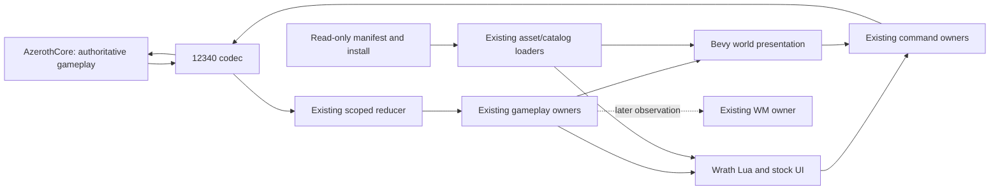

# Project B: fastest private Windows alpha, then faithful replacement

Prepared 2026-10-28, Europe/Moscow. Planning source pin:
`2cefd8a50920b0ca9c697b335561511663b6b940` on `wotlk`.

The owner confirmed: private Windows build, existing local AzerothCore server,
stock UI first, installed addons added in stages. This plan changes delivery order,
not the final requirement for faithful 3.3.5a replacement. It creates no execution
grant, server change permission, new agent assignment, or Accepted ADR.

## 1. Decision and success definition

Keep the current Rust/Bevy fork. Spend the next authorized execution block on a
current build and the real Northshire route. Fix the first observed failure and
repeat the affected step. Do not finish the entire protocol, addon or architecture
backlog before attempting the route.

Three deliverables, with different names:

| Gate | What the owner receives | Required evidence |
|---|---|---|
| A0: world-entry preview | A pinned build that enters the intended character into a visible, controllable world | Character identity, rendered terrain/actor, camera/input and grounding observations; clearly not playable-loop acceptance |
| A1: private playable alpha | A runnable Windows build with stock UI and one complete solo quest/combat/loot loop | Actual attack/spell outcome, bag/objective change, quest reward, logout/re-entry persistence, no blocking crash or Lua error on that route |
| A2: usable private alpha | A1 plus recovery, basic repeatability and the prioritized installed addons | Death/recovery, interruption/re-entry, saved settings, repeated route actions and one real behavior per enabled addon |
| R: faithful replacement | Required stock 3.3.5 and installed-mod behavior across the agreed inventory | Issue 18's complete behavior ledger and its normal/refusal/transfer/persistence evidence; no required unknowns concealed by an alpha label |

Acceptance applies to a specified build, profile, configuration and character.
An addon-disabled A1 is an explicit limited milestone, not a replacement for the
owner's final addon requirement. Human-driven combat follows the existing run rules.

## 2. What is known now

| Fact | Evidence and implication |
|---|---|
| The fork already has substantial renderer, assets, session, gameplay and stock-UI machinery | Cargo workspace, CONTEXT.md and current owner source; reuse it before importing another engine/client |
| Bevy 0.18.1, wgpu 27, Rust edition 2021 | Workspace Cargo.toml; preserve lock/toolchain for the alpha, no engine upgrade project |
| UI/app-lib compiled at 3e97bc4d | Astra's retained check; existing UI suite 3337 passed / 2 timezone failures / 1 ignored; not green and not current-head compilation |
| Later Questie timer, group-roll wire and loot-factor work exists | OC 2ffe7f61/05090606 and Astra 2cefd8a5; source only after that verification pin |
| Loot response factor now reaches the UI link | Source path through shared LootItem, LootRow and LootReads::view; server acceptance and scaled suffix text remain unproven |
| Stock smoke is a partial TOC fixture | wrath_ui_slice_tests loads through PlayerFrame.xml; it cannot establish complete stock startup or addon acceptance |
| Northshire and collision are unaccepted in the reviewed evidence | Existing run card and OC alpha checkpoint; isolated parry repair is not streamed-world proof |
| Group-roll UI is incomplete | Adapter drops count/mask/auto-pass; stock Lua also requires eligibility reasons and disenchant skill information |
| Server availability and character eligibility are live prerequisites | Old process IDs in the run card are historical, not proof the server is ready today |

Planning performed source reads and web research only. No build, test, installation,
client/server/DB/WM operation or graphical check was run for this plan.

## 3. Architecture choices that reduce delivery time

Applied design methods: codebase-design (deep modules and narrow interfaces) and
gameplay-architecture (one writer, explicit state flow). This is a delivery design,
not a new full architecture-review verdict. Existing ADR-0001 remains Proposed.
The standing no-subagent rule is preserved; alternatives were compared locally.

**Option A: targeted extensions to existing owners — recommended.** Existing
session/reducer, inventory/spell/quest owners and selected-target UI remain the
implementation. Add fields where real Wrath data would otherwise be lost. The
interface hides version-specific decoding while retaining its meaningful facts.
This has the least migration and regression burden for the current fork.

**Option B: separate Wrath domain and UI stack.** Clean isolation but duplicates
state, lifecycle and presentation work, creating a migration before a first run.
Reconsider only if measured repeated failures prove a specific existing owner
cannot express the required contract; never adopt it for aesthetic consistency.

**Option C: replace the client with another repo, or build a custom minimal UI.**
Could reduce one subsystem's work but creates an unmeasured integration surface
and discards stock-UI/addon progress. No reviewed source establishes a drop-in
12340 replacement for this customized server/install. Reference or selectively
port fixes; do not restart the project around an advertised feature list.

Preserve these implementation rules:

- AzerothCore owns durable inventory, quest, damage, loot and combat outcomes.
  Client prediction/presentation cannot declare those actions successful.
- Session/reducer owns received scope and identity; app owners consume it. UI
  reads snapshots and submits existing commands; it gets no shadow gameplay store.
- Keep version selection explicit at codec, projection and UI contracts. Missing
  facts stay unavailable; do not use fabricated constants to make stock Lua load.
- Retain existing scheduling order and scope invalidation. Inspect the relevant
  registration/call chain before changing it; do not reorder all Bevy systems.
- Address one demonstrated information loss end to end: wire → owner → UI → action
  and reply where applicable. A decoder commit alone is not a feature delivery.
- Any genuinely new ownership/protocol seam requires a narrow ADR under the
  project's conventions. Do not silently accept or relocate the existing ADR.

## 4. Critical path and timing

T0 means the beginning of an authorized execution session, not today's calendar
date. Time ranges below are planning allowances, not measured completion forecasts.
Assumptions: existing Windows toolchain/cache, working local server, available
dedicated eligible character, and the owner available for interactive combat.

| Window | Work | Exit or decision |
|---|---|---|
| T0–15 minutes | Recheck claims/HEAD; pin profile/config; confirm server/identity without exposing secrets; select existing build profile | Valid run setup or exact external blocker |
| Next 15–60 minutes | Current scoped compilation, relevant existing tests, build launcher using existing cached profile | Runnable binary or a captured first build failure; cold build may exceed this allowance |
| First authorized run, up to 60 minutes | Attempt stock world entry and existing Northshire script | A0/A1 evidence or first reproducible failure; stop the client on panic/server error |
| Next 1–3 execution blocks | Repair only demonstrated critical-path failures; targeted regression and affected-route rerun | A1 candidate, or revised estimate based on an identified subsystem problem |
| Following 2–5 work sessions | Recovery, packaging, selected addon behaviors and repeatability | A2 candidate; split addon work if the Lua/secure-host gap is larger |
| After A2 | Dependency-ordered compatibility batches, measured from observed delivery rate | Broader replacement; no defensible completion date yet |

Target a first attempt in the next execution block, not after another week of
source-only parity work. A1 in 1–3 work sessions is an optimistic planning target
only if remaining defects are local. A renderer/physics/Lua-host redesign would
invalidate it. Reforecast after the first live attempt, then after each substantial
blocker. Do not infer an ETA from commit counts or test totals.

For the proposed 90-minute OC cycle: setup, compile/build and first observation
share the same 90 minutes. A 60-minute run is a maximum inside that budget, not an
extra allowance. If compilation uses the block, retain its evidence and schedule
the run next; do not claim A0 or start an unbounded background process.

## 5. Work packages: what, who, how and completion

Use the existing issue numbers; these rows schedule them, not duplicate them.
Implementation may be prepared before dependency acceptance, but tickets are not
closed out of order. Fix observed A1 blockers before starting a deferred row.

| Order | Existing work | Owner and source area | Method and completion |
|---|---|---|---|
| 1 | Current build and launch | OC: launcher/app and current affected crates | Pin clean source; compile current changes; retain binary/hash/config/logs; no broad dependency upgrade |
| 2 | 19–22: terrain, actor, collision, replicated entities | OC: profile/assets/world/wrath | Use the existing Northshire profile; inspect first missing asset or crash; correct parser/production consumer; prove own actor and nearby NPCs with grounding |
| 3 | 23–24: movement, travel, chat, re-entry | OC: controller/camera/session/replica | Walk/turn/strafe/jump; cross the selected tile boundary; observe correction and coherent re-entry, not merely outbound movement |
| 4 | 25–26: combat, quest, loot/reward | OC integration; Astra exact UI files | Human executes existing route; trace first failed command/reply/view; confirm reward and quest state after same-character re-entry |
| 5 | A1 delivery | OC integration, owner playtest | Retain working build/config and short launch/readme; give owner executable route; do not wait for group loot or mail |
| 6 | 27: death/refusal and routine recovery | OC with Astra UI follow-through | Human-driven death/recovery; invalid target/range/cast refusal; interrupted session and stale UI cleanup; repeat affected paths |
| 7 | 12: selected installed addons | Astra, OC only for native facts | Pin exact installed TOCs/builds; use existing host plus real startup; one addon/dependency group at a time; prove a behavior, saved state and reload where relevant |
| 8 | Group loot, complete bank, mail and remaining item contracts | OC wire/domain, Astra UI | Agree shared field semantics first; implement each consumer/action/reply as one package; require real target scenarios before accepting |
| 9 | 18: full replacement inventory | Astra, owner prioritization | Extend the existing ledger by required feature families; retain unknowns and pin evidence; do not treat first-loop rows as the whole denominator |
| 10 | 16–17 and 28: WM observations/actions | OC and WM owner | After stable native loop, validate receiver → context → one allowed action → server result/human override; bridge disabled in baseline A1 |
| 11 | 29–32 and 15: live definitions/client reload | Existing WM/content owners, Astra UI | Stage versioned adoption and rollback through current owners; retain the running revision on invalid candidate |
| 12 | 13–14: optional combat/building/expansion | Explicit later assignment | Server-authoritative capability first, then UI; no procgen revival or local fake combat authority |

Addon order after stock A1: preserve the existing owner priority of WMBridge,
WM_Multiclass, WMQuestieCompat and Spellwright where their existing server features
are required; then Questie-335, Bagnon/Bartender4, aux and Postal as their native
dependencies become available. Questie's timer source is ready for validation,
not already accepted. Postal waits for a real multi-attachment mail contract.
Stock A1 must remain available as the diagnostic configuration.

The first route keeps the existing character/quest eligibility rules. Quest 6 is
stateful and cannot simply be rerun after completion. After reward acceptance,
repeat movement, inventory, login and non-consumptive interactions; use another
owner-approved eligible scenario for another full quest cycle. No DB reset,
character substitution or server administration is implicit in repeatability.

## 6. Verification workflow that accelerates development

Commands here are recipes for the executing owner's applicable grant, not commands
run by this planning session. Revalidate names and environment at the selected pin.

1. **Compile the changed seam.** For current loot integration:
   `cargo check --locked --offline -p benilla-protocol-wrath -p benilla-ui -p benilla-app --lib`.
2. **Run tests that can detect the observed failure.** Existing protocol/UI/owner
   cases first; add a narrow case only with a grant covering new tests. Run once,
   repair from evidence, rerun the affected scope when authorized.
3. **Build the actual launcher.** Reuse the warmed profile, e.g.
   `cargo build --locked --offline -p benilla` for existing dev cache or
   `cargo build --locked --offline --profile play -p benilla` for play cache.
   Inspect actual cache/build availability before choosing; don't build both to
   compare them. Cargo.toml already optimizes dev dependencies and provides play.
4. **Run the exact binary just built.** Record its path/hash/commit and use the
   existing Northshire run card's configuration, rather than launching an old exe.
   A local build is not automatically a portable package.
5. **Use the real UI fixture as a checkpoint, not the destination.** The existing
   Wrath smoke requires the absolute manifest, named profile, data path and
   `BENILLA_REQUIRE_DATA=1`; a skip is not a pass. Then exercise full production
   startup and relevant interactions.
6. **Keep one small evidence bundle per attempt.** Source SHA, binary identity,
   profile/hash, environment names without secrets, character/scope identity,
   timestamps, command exits, first error and run-step verdicts. Existing logs
   stay intact. Link evidence from the owning issue/checkpoint, don't copy it
   into multiple conflicting reports.

The two known timezone tests are a named unresolved defect. They do not imply
all new code is sound, and a blanket test exclusion is not a clean pass. For the
private alpha, record whether the symptom affects the chosen gameplay/addon path;
prioritize it immediately if it does. Keep it open for the broader release.

Use existing diagnostics before adding tooling: backtraces, startup/profile
provenance, scoped network traces, Lua errors, performance counters and crash reports.
Do not log credentials/chat contents broadly. Packet replay and small deterministic
fixtures belong at the existing pure reducer seam; they supplement live evidence.

## 7. External repos and tools: use only when they remove a known blocker

Public sources reviewed 2026-10-28. Pin a commit/version when adopting anything;
the links below are research entry points, not immutable dependency pins.

| Resource | When and how to use it | Limit / adoption rule |
|---|---|---|
| [benilla upstream](https://github.com/samwhosung/benilla) | First source for a donor renderer, input, lifecycle or UI defect; inspect a relevant fix and port its smallest applicable change | It targets 1.12.1. No blind upstream merge or assumption that its addon claims prove 12340 behavior |
| Local AzerothCore at the inspected 5e741c37 revision | First source for exact outgoing packet bodies, accepted client commands and server item/quest semantics; inspect local handlers before implementing | Actual running build/custom modules must match the reference; server source cannot prove the client's UI ABI |
| [12340 FrameXML reference](https://github.com/wowgaming/3.3.5-interface-files) and installed selected profile | Identify caller return counts, event arguments, initialization order and mandatory nil handling; use existing pinned d0339b17 reference where applicable | Installed selected data is the runtime source. Do not bundle game interface/assets into the repo or replace them with fabricated Lua |
| [wow_messages](https://github.com/gtker/wow_messages) | Cross-check a particular message/build and inspect available definitions/examples before writing another codec | README includes 3.3.5 examples but describes the world library as 1.x.y; exact message coverage must be verified. No wholesale protocol replacement |
| [WoWDBDefs](https://github.com/wowdev/WoWDBDefs) | Check whether a specific DBC has a build-12340 layout; compare field counts/types to actual selected rows and AC definitions | Historical coverage is not guaranteed; modern manifest is not a complete Wrath catalog. Never silently use a newer layout |
| [WowPacketParser](https://github.com/TrinityCore/WowPacketParser) | If logs leave a wire ambiguity, parse a compatible owner-supplied capture with database access disabled, or inspect the build-specific parser as corroboration | Existing text trace may need conversion; validate format first. Current tooling has .NET prerequisites; do not install a stack before showing it saves time |
| [wowless](https://github.com/wowless/wowless) | Consult API/schema/testing ideas for a demonstrated Lua/FrameXML mismatch; verify expansion and semantics against 12340 evidence | Its README labels it pre-alpha and describes a retail-oriented default run. Not an oracle or a replacement production Lua host |
| [RenderDoc](https://github.com/baldurk/renderdoc) | Only when valid scene data reaches rendering but the frame is wrong: capture one failing frame and inspect geometry/material/draw state | Conditional tool adoption, not a prerequisite. Installation/capture needs applicable authorization and renderer compatibility |
| [Bevy 0.18.1 docs](https://docs.rs/bevy/0.18.1/bevy/) | Resolve a specific scheduler/render API question against the pinned version | Do not follow latest-version migration advice or upgrade merely to obtain a sample |

wowdev M2/ADT wiki fetches returned 403 during research; this plan does not claim
their contents were checked. Use local parser samples/owner references first.

External-code admission checklist: exact build applicability, source/license and
attribution, transitive dependencies, small isolated diff, regression evidence,
and rollback. Treat restrictive-license projects as reference-only until reuse
terms are reviewed. No downloaded game assets or wholesale data import.

Timebox an external search to about 30 minutes per concrete failure. If no directly
applicable fix emerges, return to the local reproducer. A proposed replacement
library gets at most a half-day isolated evaluation after A1 unless the existing
implementation is demonstrably blocking all progress. Do not turn a search into
a second framework project.

## 8. Coordination and operating rhythm

- OC is the client integration owner and sole launcher of acceptance runs. Astra
  owns Lua/UI/item consumers. WM repository remains with its owner. This plan
  neither spawns agents nor sends tasks to other chats.
- At most one active implementation slice per owner and one shared integration
  pin at a time. Read claims before edits; narrow cross-owner repairs require a
  recorded handoff. Never use broad staging or shared-index cleanup.
- Prefer separate clean worktrees for new concurrent packages only when current
  ownership permits; do not reuse the already-dirty opencode/assets worktrees as
  disposable branches. Keep accepted shared work intact.
- Freeze source for each measured run. If another owner lands code, record the
  new pin and integrate before the next run rather than attributing mixed source
  to an earlier result. Preserve the last working binary/config separately.
- Daily review should take minutes: last demonstrated gate, current first blocker,
  owner, reproducer, next action and next run window. Avoid repeating the full audit.
- Schedule a short owner playtest as soon as A0 is usable. The owner performs
  combat; the agent collects allowed diagnostics and repairs afterward. Stop
  criteria in the run card remain in force.
- Close a work package with changed behavior and evidence, not a large list of
  added functions. The next package comes from the failed acceptance step.

## 9. Release packaging and rollback

For A1, provide a private versioned folder or archive containing the built client,
required redistributable project-owned files, a launch recipe and known limitations.
The install path and credentials are supplied locally, not embedded in the package.
Record dependencies that prevent portability; test launch outside the dev checkout
before calling it distributable. No public publishing or signing purchase is needed.

Use the existing local-state owner (`BENILLA_HOME` when appropriate) for a dedicated
alpha configuration. Verify stock-only addon selection through the actual enable
state; an environment-variable name is not proof all installed addons are disabled.
Do not edit the player's install or delete their addon settings. Maintain an
independent known-working alpha folder and its matching config so rollback is a
launch selection, not a destructive Git operation. Confirm how state/config schema
changes affect rollback before adopting such a change.

Minimum A1 delivery card: exact binary/source/profile, launch instructions, supported
route and character constraints, completed acceptance steps, reproducible limitations,
log location, and a way to return to the previous working build. No installer/updater
service, public hosting or cross-platform packaging work before this is useful.

## 10. Risks and decision triggers

| Observed risk | Response | Escalation trigger |
|---|---|---|
| Build failure after source-only commits | Fix current compilation first; compile affected graph | Two bounded blocks without a localized failure: reduce to last known compiling seam, preserve all later work |
| Grounding/asset failure | Capture exact tile/model/profile and first failing phase; use existing parry reproducer if relevant | Same failure persists after two hypothesis-driven fixes: focused architecture diagnosis, no random parser shifts |
| wm-hd-only failure | Pin archive provenance; compare with base profile if that comparison is authorized and scenario-compatible | Do not silently replace the owner's profile. A base-only preview is labeled and separately agreed as the first delivery |
| Whole stock UI fails after partial smoke passed | Load actual startup; fix first missing contract through its existing owner | Repeated unrelated failures: bounded dependency inventory of the failing TOC segment, not all APIs |
| Addon secure/Lua behavior requires major host work | Keep stock A1 usable; pin exact addon behavior; estimate a separate host package | No speculative switch to another Lua runtime without a bounded prototype and ownership decision |
| Group loot cannot supply reason/skill fields | Recover native/catalog derivation, extend shared contract once | Do not infer reason IDs from vote-mask absence or invent disenchant skill |
| Server/character unavailable | Keep build and launcher preparation moving; request exact missing identity/access | No DB reset, alternate account or administrative workaround without authorization |
| A1 is stable but progress stalls on parity | Schedule next highest-value user scenario from issue 18 | Public release/full replacement waits for its larger gate; alpha scope does not erase required features |

Proposed usability targets for A2, measured on the owner's recorded hardware and
resolution: a 30-minute ordinary session without a crash or blocking Lua error,
no fall-through/stuck movement on the selected route, and repeatable same-character
re-entry. Measure frame-time p50/p95 and memory trend before choosing numerical
performance budgets. Do not invent a measured FPS target or optimize unobserved code.

## 11. Permission state and immediate next actions

The earlier Astra 30-minute grant is consumed. The suggested OC 90-minute prompt
is authorization only if the owner actually sends it to the executing chat; drafting
it here does not establish that it ran or transfer its budget to Astra. This planning
request permits planning/research, not inferred installations, live DB edits or
an autonomous verification campaign. An execution owner should use its already
applicable grant without asking again, and otherwise request one concrete bounded
package rather than asking before every command. No scheduled automation is created.

Next actions, in order:

1. OC reconciles HEAD with 2cefd8a5 or newer, confirms the exact execution grant and
   starts current-build → Northshire evidence. Do not start bank/mail/group-loot
   completeness first.
2. Astra remains available for the first demonstrated stock-UI/item blocker; prepare
   its exact caller/owner/reference contract without concurrent source churn during
   the run. Do not add more speculative bindings to increase a coverage count.
3. Owner performs the combat section and reports input/feel failures at the pinned
   route. Retain A0 if useful, even if A1 exposes another blocker.
4. Integrate the smallest fix, rerun the affected path under the current budget,
   and deliver a usable A1 folder as soon as the gate passes.
5. Reforecast from measured build/run/fix times and choose the first A2 addon/recovery
   package. The full replacement ledger remains the long-term acceptance authority.

Local anchors: [Northshire run card](../run-cards/2026-10-27-northshire-loop.md),
[completion queue](../completion-index.md), [item consumer handoff](../handoffs/2026-10-27-astra-wrath-item-query-consumer.md),
[OC group-loot checkpoint](../checkpoints/2026-10-28-oc-wrath-group-loot.md),
[prior verification](../verification/2026-10-28-astra-bounded/summary.md),
[Proposed ADR](../../../docs/architecture/adr-0001-wrath-compatibility-boundary.md).
