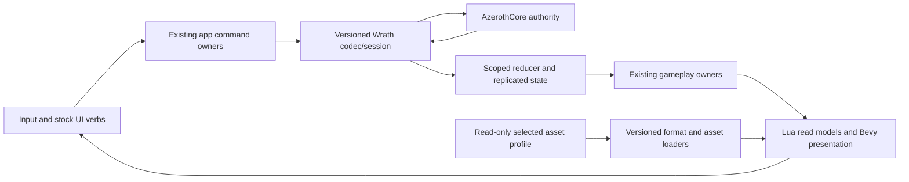

# Playable client foundation — implementation draft

Date: 2026-10-29. Audience: OC and owner. Planning pin: `b03a919b`, branch `wotlk`.
This is a delivery draft, not an Accepted ADR, feature-completion claim, or new server-operation grant.
It refines [the delivery plan](2026-10-28-private-alpha-delivery-plan.md). Existing issues remain the tracker; do not create a parallel ticket system.

## Product to deliver

A private Windows client for the existing AzerothCore server, using the owner's selected 3.3.5a assets and stock UI. The owner can choose the intended character, see a correctly dressed and animated body, walk through a coherent world, interact with NPCs, complete a solo quest involving combat and loot, receive the reward, and log back in with the server-confirmed result intact.

The first release is a bounded solo experience. It must look usable as well as exchange packets. Full Wrath replacement, all installed addons, raids, vehicles, WM extensions, building, generated spaces and new combat mechanics follow separately. Deferral changes scheduling, not the final fidelity requirement.

## Evidence at the planning pin

- Source observed: token/resolver repair `b03a919b`; its previous session recorded 14 Wrath tests and 91 unit tests passing. No rebuilt/live binary acceptance for that commit.
- Historical bounded runs entered world around 2.4–2.6 GB private memory after the M2 particle guard. This is short-run evidence, not a sustained memory result.
- Open graphics evidence: missing player body, solid-white chat region, suspicious vegetation/material appearance. The latter is a symptom to diagnose, not a proven alpha-blend cause.
- Nonempty version-264 M2 particles are refused to avoid the demonstrated allocation problem. Effects remain incomplete.
- Dirty OC changes at planning time: `crates/benilla-app/src/wrath.rs` adds root visibility components; `crates/benilla-ui/src/script/mod.rs` installs glue CVars. Preserve and assess these changes before editing. They do not prove the graphics/startup defects fixed.
- Focus/vehicle/boss resolver fields exist; production population remains incomplete. Callable pitch no-ops are not vehicle support.
- Connected movement, quest/combat/loot/reward/persistence acceptance is absent. A0/A1 remain open.
- Old handoffs name a character/zone inconsistently with later screenshots and world IDs. Re-establish GUID/map/position/profile per run; never select a route from a minimap label alone.

## Release gates

| Gate | Required result | Evidence |
|---|---|---|
| A0: world-entry preview | Intended identity, readable stock UI, visible own body and NPCs, correct camera, terrain and grounding, basic movement | Actual client at pinned location/profile, body identity trace, input and collision observation; no worldview substitution |
| A1: private playable alpha | A0 plus target/interact → accept quest → fight → loot → turn in/reward → logout/re-entry; bags, action bar, health/power, quest log, map and error feedback usable | Human-driven route, server outcomes and rendered states, persistence after fresh login; no blocking exception or graphical obstruction |
| A2: usable private alpha | A1 plus death/recovery, refusal paths, disconnect/re-entry, saved settings, sustained run and selected addon behaviors | Repeated relevant actions, recovery scenarios, measured performance, launch instructions and known limitations |
| R: faithful replacement | Full required Wrath and installed-mod inventory | Existing full replacement ledger; all mandatory normal/refusal/transfer/persistence cases closed |

No API count, test count, entity count, successful build or screenshot alone closes A1.

## Capability inventory and scope

“Present” below means candidate machinery exists, not that Wrath behavior is accepted. OC must inspect and reuse it before adding anything.

| ID | Capability and required behaviors | First gate | Existing implementation entry points | How acceptance fails |
|---|---|---|---|---|
| F01 | Launch/config: stable selected profile, private identity loading, useful startup failure, logs and shutdown | A0 | launcher, `benilla-app` local_state, glue_session, wrath | Silent exit, wrong profile, exposed secret, stale binary |
| F02 | Session/character: auth, roster/explicit intended selection, loading, world identity, orderly logout | A0/A1 | `benilla-protocol-wrath` session/logon/world; app wrath/glue_session/ui_char | Auto-entering an unintended character or stale session state |
| F03 | World assets: terrain textures/layers, WMO buildings, props, water, collision, patch precedence | A0 | profile/formats/assets/world crates | Missing walkable ground, obstructive wrong texture, invalid transforms |
| F04 | Actors: own/NPC models, skin/geosets/equipment, scale, pose, animation and visibility | A0 | app player/entities/wrath; assets model/m2; world model_render/rig_anim | Player invisible, wrong identity, severe mesh/pose corruption |
| F05 | Camera/input: orbit, zoom, mouse look, move/turn/strafe/jump, keyboard focus, window resize | A0 | app player and bindings; UI input | UI steals movement indefinitely; camera inside body; control stuck |
| F06 | Movement: grounding, collision, slope/steps, network movement/corrections and tile crossing | A0/A1 | player controller/movement_net/wire_in; world collision/terrain_stream | Walk through required walls, fall through ground, repeated snapback |
| F07 | Target/interact: click/tab/clear, range/reaction, target frame, NPC gossip and quest opening | A1 | target, ui_unit, ui_gossip, ui_quest, script unit | UI target and command GUID disagree; interactions silently fail |
| F08 | Combat: known spells/actions, target/cast/attack/cancel, cooldown, resource use, damage/death feedback | A1 | spell, ui_action, ui_cast, combat_log, wrath codec | Local animation reported as a hit without server outcome; stale cooldown |
| F09 | Quest: offered/active/completed states, text/objectives/watch, progress, reward choice, refusal | A1 | ui_quest, ui_quest_log, stock Quest/Watch frames | Wrong objective count, unusable dialog, reward sent for wrong quest |
| F10 | Inventory/loot: corpse loot, money/items, bag slots/stacks, item identity/link, equip/use, full-bag error | A1 | ui_loot, ui_items, items, item_lane, script loot | Lost suffix/count, false pickup success, stale bags after reply |
| F11 | Core UI: player/target bars, action bar/tooltips, bags, quest log, chat, readable text/icons, map/current zone/close | A1 | ui_script, ui_pass, ui_text, ui_world_map; benilla-ui | White obstruction, wrong health, repeating Lua error, trapped map |
| F12 | Feedback: cast/impact visibility, basic interaction/combat sounds, clear error text | A1 | spell/aura_visual/sound; world particles/ribbons | Outcomes cannot be understood; silent unsupported effects counted complete |
| F13 | Persistence: reward/inventory/quest/location from server after relog; settings from local_state | A1 | session, domain owners, ui_saved, cvars/local_state | Cached prior-session values masquerade as persisted state |
| F14 | Recovery: death/release/corpse/resurrection, disconnect, denied/out-of-range action, reconnect | A2 | death, ui_session/ui_logout, protocol session, player | Softlock or stale entities/UI after recovery |
| F15 | Everyday services: vendor, trainer, repair, bind/hearth, travel/swim, basic chat | A2, route-dependent | ui_merchant/ui_trainer/ui_binder/ui_taxi, player, ui_chat | Required route service unusable; elevate to A1 if needed on chosen route |
| F16 | Packaging/performance: repeatable launch, bounded memory, responsiveness, diagnostics | A1 basic/A2 sustained | launcher/config/profile; perf/journal, shutdown | Owner needs an agent to launch; prolonged freeze; runaway memory |
| F17 | Party/group loot/trade/bank/mail/auction/social/guild/talents/professions | After solo A1 | existing ui_* owners plus lossless Wrath codec | Broad subsystem presence mistaken for tested Wrath contracts |
| F18 | Focus/pets/vehicles/encounters/PvP/instances/transports and all race/class combinations | Staged replacement | resolver plus actual production owners to audit | Dummy zero/no-op declared implemented; route uses unsupported feature |
| F19 | Installed addons and WM integration | After stock A1, existing priority order | loader/VM; existing native bridge/WM owner | Addon loads but essential behavior/saved state fails |
| F20 | Hot reload, souls combat, building, procgen | Later explicit packages | existing extension boundaries | New feature work delays the baseline playable loop |

If the chosen existing character requires a deferred capability (mount, pet, custom class, etc.), either implement that actual dependency or use an owner-approved eligible route/character. Do not silently substitute accounts, teleport, reset quests or alter the DB.

## Architecture foundation: retain owners, repair contracts

| State | Writer / responsibility | Consumers and invariant |
|---|---|---|
| Durable combat/items/quests | Server; client reducer applies received facts | UI never invents successful outcomes |
| Session identity/entity lifetime | Session/reducer and existing app replica projection | GUID plus scope; clear stale data on terminal transition |
| Predicted local motion | Existing player controller; server corrections reconciled through current path | Camera/render read motion; prediction does not become server authority |
| Current target/local focus intent | Existing command/selection owner, with version-specific semantics | Unit APIs and outbound actions resolve the same identity |
| Health, power, auras, inventory, quest views | Existing domain owners project received state | One authoritative source per fact; no second Lua gameplay database |
| Asset/catalog identity | Selected manifest + version-aware loaders | Exact resolved path/archive/version reaches every renderer and UI consumer |
| Render entity/pose/material | Existing world presentation owners | Logical entity identity is traceable to model root and mesh children |
| UI frame state/settings | VM and existing local_state/CVar owners | VM client target defines ABI; wire flags cannot switch host mode |

Logical update contract (inspect existing Bevy schedule before edits): admit network input → apply scoped state → project domain snapshots/identity → dispatch relevant Lua events with new values available → process UI commands via existing command queue → update presentation → extract/render. Preserve existing scheduling where it already meets the contract; no broad schedule rewrite.

Every repaired action should have a short contract: input and identity, opcode/body, expected response/refusal, owning state mutation, UI event/read values, rendered result, scope-reset behavior. Preserve count/mask/suffix/unknown-versus-zero distinctions across adapters. Extend existing models only where evidence shows loss; a new seam requires the project's ADR process.

## Work order and delivery slices

| Order | Package | Exit | Dependency |
|---|---|---|---|
| P0 | Revalidate source, dirty ownership, binary/profile, run recipe and actual identity | Reproducible bounded run; list first blocker | None |
| P1 | Own-player render chain and obstructive world/UI graphics | Body is identified/rendered; world/UI usable at original spot + adjacent state | P0; detailed graphics draft |
| P2 | Input/camera/grounding + minimum stock UI semantics | Walk/turn/target/interact, bags/map close, truthful bars | P1; fix relevant startup errors alongside it |
| P3 | One vertical quest/combat/loot slice | Every action reaches server and returns visible state | P2; human combat |
| P4 | Reward/relog, launch instructions and A1 candidate | Owner completes route and sees persistence on exact build | P3 |
| P5 | Recovery, services, sustained behavior and prioritized addons | A2 evidence | P4 |
| P6 | Broader Wrath inventory + deferred effects/feature fidelity | Per-feature replacement ledger | No silent narrowing of R |

P1 includes enough correct effect presentation for the selected combat route. A full particle-system repair may be its own cohesive package; never remove the memory guard before replacement decoding is bounded and validated. If required effects remain missing, A1 remains blocked or the owner explicitly agrees to a named visual limitation. Do not silently lower the gate.

Work in bounded 60–90 minute investigation/implementation blocks, not a promise to finish each package within one block. Start with one reproducible symptom, one falsifiable cause, one small fix, targeted checks and the original symptom rerun. At block end retain the exact finding/next action; stop unproductive random edits. Build time is inside the block; a long-running build can continue with status updates and a declared bound. Forecast completion only after P1 and P2 identify the remaining dependencies. The previous optimistic 1–3-session estimate is not current evidence.

## Verification and delivery contract

Reuse cached toolchain/profile and existing probes. Current user history authorizes needed verification; this draft does not require a renewed blanket permission request. Preserve the no-unattended-combat rule and existing server/install boundaries.

- Pure protocol/parser regression for the actual malformed/versioned case, including bounds and vanilla preservation when shared.
- Owner/UI tests for mutation → read/event → invalidation; use real data where relevant and report skips.
- Build the actual launcher once affected checks pass; record source/dirty patch identity and binary SHA-256.
- Start with existing 55-second/5-GiB bounded probe. Stop owned client on limit; a deadline stop is not a crash or a completed gameplay route.
- Longer A1/A2 runs require an interactive operator and explicit runtime bound. Proposed A2 measurement: 20 minutes including the route, steady-state frame-time p50/p95/p99 and >250-ms hitches, memory at start/end/peak. Provisional target: p95 <=33.3 ms after initial loading, no input freeze >1 s, private memory below 5 GiB and no sustained growth during stationary tail. These are proposed product targets, not measured results; record hardware/resolution/build/settings and revise openly if unsuitable.
- Distinguish source, test, production ingestion, rendered behavior, server result and persistence. Mark each capability unverified/failed/passed with the exact evidence pin, never “done” from compilation.
- Deliver executable/config instructions without bundled game assets or credentials. Record known limitations and an easy return to the prior working binary/config. Do not clean shared target/evidence folders to save space without explicit scope.

## Reference and shortcut policy

Use local pinned AzerothCore for packet bodies; installed selected-profile FrameXML/GlueXML for caller ABI; versioned DBC/model data for layout; existing donor code for lifecycle and renderer mechanics. The earlier delivery plan lists external research entry points. Consult them only for a concrete missing fact, verify exact build/version and license before porting, and cite the finding. Server sources do not define client UI return arity; vanilla reference does not define Wrath layouts.

Fast paths: reuse existing owners and diagnostics, deterministic tiny fixtures, one selected profile/build, same-location comparisons, stock UI before addon groups. Avoid engine upgrades, whole-repo imports, custom replacement UI, fake API success, generic scaffolding frameworks and speculative refactoring. No new dependencies are proposed here.
