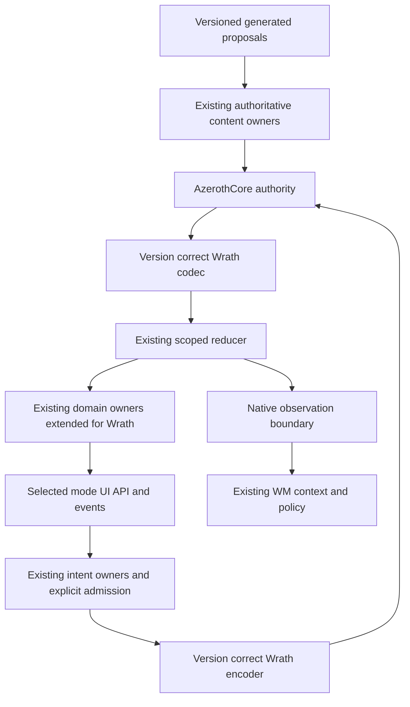

# ADR-0001 Lossless Wrath contracts through existing owners

## Status

Proposed. The owner confirmed the problem framing and selected this alternative for drafting on 2026-10-26. Approval to write this record is not acceptance of the architecture or permission to execute checks. Independent review is pending.

## Date

2026-10-26, Europe/Moscow.

## Summary

Preserve the existing server, WM, reducer, application and UI ownership structure while extending required models and interfaces to represent Wrath semantics without permanent lossy vanilla projections. Decode/encode by protocol version; expose selected-mode UI contracts honestly; record required missing semantics as release blockers.

## Engine Compatibility

| Field | Value |
|---|---|
| Engine | Bevy 0.18.1, pinned by workspace Cargo.toml/Cargo.lock; Rust edition 2021 |
| Domain | Networking, Core, UI, Input, persistence and content integration |
| Knowledge Risk | Formal engine-reference classification unavailable; no configured engine-reference library or specialist exists. Rely on pinned source and version-specific documentation for API facts. |
| References Consulted | Local Cargo.toml/Cargo.lock, Wrath plugin scheduling and domain owner source; official Bevy 0.18.1 Message documentation |
| Post-Cutoff APIs Used | No new engine API is selected by this ADR. Existing Message/System/World scheduling surfaces are retained, subject to implementation review. No training-cutoff risk rating is invented. |
| Verification Required | Explicit system ordering/scope barriers, message lifetime and bounded channel behavior; selected-mode UI/event/API contracts; connected behavior and performance at a pinned build |

The source review did not establish complete engine compatibility, deprecated-API coverage or cross-platform behavior. A version pin and an earlier compiler report are not substitutes for those checks.

## ADR Dependencies

| Field | Value |
|---|---|
| Depends On | No prior formal ADR exists. Constraints derive from the approved Project B completion plan and current authoritative owner contracts. |
| Enables | Incremental lossless Wrath domain/UI migration, complete inventory/combat behavior, explicit queue/admission contracts and later compatible WM action interfaces |
| Blocks | Declaring a required lossy projection complete or accepting full stock replacement while necessary Wrath behavior is unrepresentable |
| Ordering Note | Fix demonstrated packet/flag defects in OC's already authorized source lane; do not make unrelated fixes wait for acceptance of this Proposed ADR. Exact data schemas and new API changes require their own reviewed implementation contracts. |

## Context

### Problem Statement

The fork speaks 3.3.5a to AzerothCore but reuses many 1.12 update fields, commands, result types, UI APIs and addon contracts. Reuse preserves useful implementation ownership, but numeric and structural similarities have been mistaken for semantic equivalence. Source review found wrong movement bits and item damage counts; the existing bank projection and addon interface also cannot express full required Wrath behavior.

### Constraints

- Full stock-client replacement is mandatory; a documented required loss still blocks release unless the owner changes scope.
- AzerothCore owns authoritative and durable gameplay state. Existing WM owns orchestration and content publication. The client owns received state and local presentation/prediction.
- Preserve the existing reducer, ECS/inventory/UI owners and donor behavior where intentionally retained. Avoid a parallel authoritative model, duplicate WM brain or wholesale UI rewrite without a demonstrated dependency.
- Keep baseline Wrath protocol free of experimental traffic. Donor Vanilla compatibility is a separate mode, not the definition of the Wrath baseline.
- One writer per claimed file set; cohesive explicit-path commits; no assumption that another worker's dirty source is ours to commit.
- Existing execution, install, server/DB and deployment restrictions remain in force. No performance budgets or live evidence are invented.

### Requirements

Represent all required Wrath field widths, capacities, flags, identities, item/class/expansion state and UI contracts at their owning boundaries. Admit ordered critical actions explicitly, preserve world/session identity, and make unsupported or rejected semantics observable. Preserve provenance and authoritative outcome correlation across WM and generated-content seams.

## Decision

Extend existing owners with lossless version-aware contracts. The received Wrath state remains a projection of server authority; introducing a version-aware field does not create a new authority. Decode the complete source-version structure first, validate it, then project deliberately into an existing owner whose model can express every required value.

Shared code may reuse equivalent behavior. Where meanings differ, use explicit selected-mode mapping. A donor numeric constant, array size, API return shape or event signature must not cross the boundary merely because its name looks familiar. Unknown optional variants may be refused with diagnostics; required unsupported variants remain tracked blockers rather than silently omitted features.

Temporary donor projections are allowed as incremental implementation stages when losses are named and traceable. They are never the final compatibility policy. Extend the existing inventory/spell/progression/UI owner when a required Wrath value cannot fit; do not store an authoritative shadow copy beside it just to hide the problem.

Critical command admission must produce a defined accepted/refused outcome. Movement coalescing applies only to replaceable motion and must not evict quest/cast/logout/content transactions. Replies and lifecycle barriers require explicit bounded retention/backpressure or controlled terminal overload behavior. This ADR states those invariants; the concrete queue capacities, envelope types and result API remain implementation decisions to be reviewed separately.

### Architecture Diagram

### Key Interfaces

Mode boundary: donor Vanilla, Wrath baseline and negotiated enhanced behavior are distinct concepts. UI identity, API/event returns and addon interface gates follow the selected contract, not an unconditional global donor identity. Reporting a Wrath version without implementing its behavior is insufficient.

Wire/domain boundary: mappings identify protocol build, units, enum/flag meanings, array capacity, conditional payload rules, unknown-state semantics and failures. Domain owners retain server GUIDs and scope; rendering entity IDs do not become cross-process identities.

Intent/result boundary: ordered action admission, authoritative outcome/refusal, duplicate/timeout/cancellation and human override are explicit. An observation channel does not become an arbitrary mutation channel.

Content boundary: immutable request/revision/catalog identity, staged validation/adoption, result and rollback are required. Generated local data remains a proposal until an existing permitted owner accepts/publishes it. No durable serialization schema, new wire format or registry stance is accepted by this ADR draft.

## Alternatives Considered

### Alternative 1 Permanent vanilla projections

Keep all shared state/UI types restricted to the donor contract and truncate or ignore extra Wrath semantics. Benefits are minimal initial changes and broad reuse of donor tests. Costs include unaddressable bank/item state, incorrect addon/API behavior and permanent expansion-feature limits. Rejected as the preferred direction because it conflicts with the mandatory full replacement requirement. It remains a temporary implementation stage only when visibly Partial.

### Alternative 2 Wholesale domain and UI replacement

Build a separate Wrath application model and UI host, then migrate all behavior. It offers clean version-specific modeling but duplicates mature owners and greatly increases integration, lifecycle and regression work. Not selected: current evidence justifies targeted owner extension, not discarding the working reducer/ECS/UI architecture.

### Alternative 3 Explicit version-aware extensions to existing owners

Retain shared implementations where equivalent and extend interfaces/data where required. Benefits are locality, incremental migration and visible fidelity. Costs are broader models, explicit mode branches and the need to maintain both donor regressions and Wrath acceptance. Selected for this Proposed ADR after owner confirmation of alternatives.

## Consequences

### Positive

Existing ownership and useful code survive. Required gaps become explicit rather than disappearing in adapter defaults. Version semantics can be reviewed and checked at narrow seams. Baseline behavior and experimental publication remain separable.

### Negative

Some shared models and UI contracts must change; an adapter-only solution is insufficient. Donor tests will not prove Wrath compatibility. Broad replacement coverage still requires a sustained behavior inventory and connected evidence. No acceleration claim follows from the selected pattern alone.

### Risks

Uncontrolled mode branches can spread through every subsystem; keep version decisions at owning interfaces and reuse equivalent mechanisms. Dual representations can drift; preserve one owner per state and define projections rather than competing mutation paths. Queue repairs can drop important semantics if all messages are treated alike; classify ordering and replacement rules before implementation. New data/caches can outlive scope; retain explicit retirement and revision identities.

## GDD Requirements Addressed

No formal GDDs exist in the configured skill layout. The owner explicitly approved the existing Project B plan/contracts/issues as the baseline instead. This table records that substitution without claiming formal GDD coverage.

| Approved source | Requirement | How the proposed boundary addresses it |
|---|---|---|
| Completion plan sections 1/8; issue 18 | Full stock replacement without silently excluded required features | Unrepresentable required semantics remain release blockers |
| C07–C09 / issues 22–24 | Scoped replicated world, movement and re-entry | Version-correct state/motion and lifecycle identity through existing owners |
| C10 / issue 25 | Real attack/spell outcomes and refusals | Semantic codecs, complete owning models and authoritative results |
| C11 / issue 26; release economy family | Quest/loot/reward with inventory persistence | Lossless required inventory capacity/attributes and ordered critical intents |
| C12 / issue 27 | Death/recovery and invalid action handling | Explicit state transitions and server-owned outcome/refusal |
| Release UI/addon family | Stock 3.3.5 UI/API/events and required addons | Selected-mode identities, return shapes and version-aware behavior |
| C13 / issue 28; authority table | WM observation/action with override | Existing WM ownership and a bounded intent/result boundary |
| C16/C17; platform generation | Versioned content with validation and rollback | Revision/catalog identity and existing-owner publication, without implying consumer implementation |

## Performance Implications

- CPU: explicit mappings and validation add work; avoiding duplicate owners limits repeated processing. No measured overhead or target is established.
- Memory: complete Wrath models may exceed donor sizes. Ordered queues need defined bounds; do not claim the current unbounded reply channel meets them.
- Load Time: complete format/catalog/UI validation may expose previously skipped data. Profile staging must account for peak memory and consumer rebuilds.
- Network: protocol-correct fields and results replace misinterpretation; new extension traffic remains prohibited in Wrath baseline mode. No new packet protocol is chosen here.

## Migration Plan

1. Source-correct OC's movement bits, item damage count and critical command eviction. Keep exact references and pending checks in the review.
2. Inventory every narrowed boundary and selected UI contract; prioritize the pinned quest/combat/re-entry path, then expand through the full ledger.
3. Extend the existing owning model and consumer together in each cohesive slice. Preserve donor behavior through explicit mode/layout handling.
4. Link accepted interface decisions and implementation/evidence to stable requirements. Do not count this Proposed record as accepted coverage.
5. Complete authorized compiler/focused checks and connected scenarios at exact source/binary/profile identities. Track unknowns and refusals explicitly.
6. Advance WM/content/generation through existing publication owners after their own decision/acceptance gates. Preserve the unresolved restart/native-geometry decisions.

## Validation Criteria

Source contracts must distinguish the true Wrath flag/count/capacity from donor representations, retain complete required values, and expose refusals. Future authorized checks must cover normal and malformed packets, action bursts with movement, reply overload, unknown→known zero, terminal/new-scope ordering, full required bank/item state, selected-mode addon/API/events, and quest reward persistence after re-entry.

No check is executed or test file authorized by this ADR. A matching test file does not equal passing evidence. A connected route is an intermediate proof; all mandatory replacement rows and operational gates must close before release.

## Related Decisions

- [Architecture source review](architecture-review-2026-10-26.md), completed before this ADR was drafted.
- [Traceability baseline](architecture-traceability.md), with formal gaps and pending independent review.
- Approved plan: `D:/WOW/PROJECT_B_COMPLETION_PLAN.md`.
- Existing ownership/contracts: `docs/baseline/owner-decisions.md`, `docs/baseline/seam-maps.md`, native bridge source and latest OC checkpoints.
- [Procgen boundary](../procgen/design.md).

## Review and Registry Notes

Review mode resolves to lean because no configured review-mode file exists. No engine specialist is configured; no specialist/subagent or TD review was run. No architecture registry was created or updated. Possible future registry candidates are the existing authoritative state ownership, explicit selected-mode contracts and semantic command admission; these require separate explicit approval and must not be treated as new accepted stances from this Proposed record.

This session reviewed pre-existing source before authoring the proposal. It did not independently review this new ADR or declare it Accepted. Use a fresh review context for the next architecture-review run.
