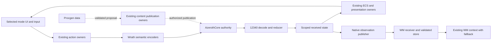

# Project B architecture and implementation review

Date: 2026-10-26, Europe/Moscow. Author: Astra. Audience: project owner and OpenCode. Source anchor: `df8c7527`; source findings below were read from that checkpoint. Status: SOURCE REVIEW COMPLETE; replacement readiness FAIL. No new project execution evidence.

## 1 Abstract

Project B has a useful foundation: a time-free Wrath reducer, explicit session/world identity, shared presentation and inventory owners, manifest-backed assets, a scoped native observation channel, and isolated generation algorithms. Recent work connects previously separate pieces into the application. Preserve these investments.

The current implementation cannot yet satisfy the approved full stock-client replacement requirement. Three concrete source defects affect the first gameplay scenario: wrong outbound movement flags, incorrect item-response damage count, and movement eviction of critical commands. The broader structural limit is the use of a 1.12 domain/UI contract as though it fully represents 3.3.5 behavior. Bank capacity and addon identity make that limit visible today. More source files or passing donor-host tests will not resolve it by themselves.

This review used the approved Project B completion plan, issues 16–32, contracts, source and pinned server definitions with the owner's explicit approval. There were zero formal GDDs and zero ADRs in the skill-expected locations at the start. The missing studio/engine-reference/architecture registry scaffolding is recorded, not silently fabricated. The companion matrix contains 37 planning/release anchors; it is not an exhaustive compatibility inventory or project completion denominator.

The Proposed ADR written after this source review is a recommendation, not accepted architecture and not independently validated by this same session.

## 2 Goals and Non Goals

Evaluate current architecture and source against full stock replacement; identify useful implementation choices, concrete defects, capability gaps, operational risks and the next owned work. Separate component existence from compilation, focused tests, rendered gameplay, receiver acceptance and production WM consumption.

Do not reduce release to Elwynn, replace the existing WM brain, move authority into the client, invent feature percentages, restart the donor architecture, modify OC-owned source, execute checks or change deployment. Experimental combat, functional building and generated spaces remain platform goals; their intermediate prototypes do not satisfy their final acceptance.

## 3 Background and Problem Statement

The donor implements a 1.12 client in Rust/Bevy. The fork must replace a 3.3.5a client against the existing AzerothCore/WM installation. Protocol retargeting therefore changes packet layouts, enum meanings, update fields, UI/API behavior and data variants together. Adapters can reuse implementation owners but cannot make missing semantics disappear.

The current runtime starts a Wrath worker, reduces packets into GUID-keyed state, exports a world digest, projects it into the existing ECS/UI owners, and translates stock client commands back onto the Wrath wire. This is a reasonable incremental path. Its present code still assumes equivalence where version-specific contracts are required.

### Findings ordered by impact

| ID | Priority | Finding | Consequence and owning action |
|---|---|---|---|
| R01 | P1 | Movement writer defines Wrath falling as `0x2000` and swimming as `0x02000000`; the server uses falling `0x1000`, swimming `0x00200000`, and flying `0x02000000`. | Swimming is labeled flying; jumping/falling flags and conditional tails disagree with the server. OC must translate semantic motion and serialize each conditional tail from actual Wrath flags. |
| R02 | P1 | `read_item_info` reads five damage triplets; the pinned server sends two. | The decoder consumes 36 bytes from later fields as damage. Armor, resistances, delay, spell blocks and later strings become misaligned or parsing fails. OC must use the 12340 count before projecting onto donor types. |
| R03 | P1 | Action commands and movement share one outbox. Actions admit up to 256 entries, but movement pops the front at 64 entries. | A movement tick can remove a queued quest/cast/logout command. Full/unsupported commands are also silently discarded. OC must preserve ordered critical commands and make admission/refusal explicit; coalesce only semantically replaceable movement. |
| R04 | P2 | Gameplay replies use an unbounded channel while the frame loop drains only 64 per tick. | Sustained production faster than consumption has no hard backlog bound. Specify bounded ownership/backpressure or a controlled terminal overload policy without blindly dropping ordered gameplay/terminal events. No memory exhaustion was reproduced. |
| R05 | P1 release gap | Addon gate requires interface `11200`; build identity remains `1.12.1`/`5875`; `GetBuildInfo` retains the donor return shape. | With version checking enabled, it refuses Wrath addon interfaces, and addon API branches see a donor identity. Forced loading cannot implement the missing API/event semantics. OC needs explicit mode-aware host contracts and a stock 3.3.5/addon behavior matrix. |
| R06 | P1 release gap | Shared inventory projection drops four Wrath bank slots and one bank bag; enchant and suffix/scaling/socket semantics are also narrowed or absent. | Required persistent state cannot be completely addressed/displayed through the present model. Extend existing owners; documenting a required loss does not waive full replacement. |
| R07 | P2 | Initial spell replies are projected with empty cooldowns; full aura/cooldown and other gameplay variants remain outside the current slice. | A spellbook list does not establish usable combat state after entry/reconnect. Complete selected behavior owners, then expand class/role coverage. |
| R08 | P2 architecture gap | Reader reload and candidate-first archive replacement exist, but do not establish atomic catalog/GPU/UI revision adoption or rollback. | Live source reopening is a component capability, not C16/C17 completion. Pin revision identity and stage/commit all affected consumers before claiming a live-content transaction. |
| R09 | P2 architecture gap | Procgen output retains static part references, seed/version and a fingerprint, but no durable request/artifact codec or production consumer. | Replay/persistence and server publication remain proposals. Astra owns the bounded durable handoff; do not publish generated actors/items as authoritative client state. |
| R10 | P2 coordination | Older producer docs still describe v2 while current Rust/Python constants say v2.1; the approved plan's old GLM staffing/format snapshot is superseded. | Readers can implement stale contracts or repeat completed parser work. Keep requirements intact; make source identity and current owners explicit and reconcile historical claims at their use sites. |

R01 evidence: `crates/benilla-app/src/wrath.rs:2190–2296`; `crates/benilla-protocol-wrath/src/updates.rs:23–28`; pinned server `Entities/Unit/UnitDefines.h:381–397`. This is a source contradiction, not a reproduced server rejection.

R02 evidence: `crates/benilla-protocol-wrath/src/gameplay.rs:769–799`; server `Entities/Item/ItemTemplate.h:613` (`MAX_ITEM_PROTO_DAMAGES=2`) and `Handlers/ItemHandler.cpp:451–455`. The stats count is also silently clamped with `.min(64)` rather than rejected/fully consumed; malformed counts must not shift the cursor.

R03/R04 evidence: `wrath.rs:482`, `592`, `1477–1483`, `2293–2298`. A valid source interleaving is an action burst leaving 64+ entries before the Stream stage; its next movement write removes the earliest entry regardless of opcode. The worker may drain earlier in a particular run, but no ordering guarantee prevents this interleaving.

R04 status note (2026-11-05): re-prioritised to P1 by the 2026-11-05 release plan; the unbounded reply channel is replaced at source by a bounded, non-blocking queue with reserved terminal slots (see [bounded session delivery](bounded-session-delivery.md) and traceability rows R04.a/R04.b). This is a source repair only: no compilation, focused check, receiver or visible-run evidence exists, so the review finding is not closed.

R05 evidence: `crates/benilla-ui/src/script/addon_gate.rs:14,108`; `script/client.rs:10–12,134–144`; donor surface/event-shape tests in `benilla-app/src/ui_script/mod.rs:935–954`. These tests are valuable for donor behavior; they cannot establish a different version's contract.

R06 evidence: `wrath.rs::push_player_inventory_fields` maps only 24 bank slots and six bank bags; `push_item_fields` projects only the smaller donor enchant window. See the existing item-replication checkpoint for declared omissions. R07: `gameplay.rs::read_initial_spells` and `wrath.rs:981`. R08: `benilla-profile::Profile::reload`, `benilla-assets/src/profile_source.rs::ProfileAssetReader::reload` and the separately opened catalog chain. R09: `benilla-procgen/src/lib.rs::ProcgenOutput` and `docs/procgen/design.md`. R10: producer contract versus current observation constants and later checkpoints.

## 4 Proposed Architecture

Preserve the current authoritative ownership graph:

The recommendation is to extend existing owners with required Wrath semantics and explicit version-aware projections. Avoid a second world replica or WM director, permanent truncation as a compatibility policy, and a wholesale rewrite that discards the working engine/UI ownership structure. The corresponding ADR remains Proposed.

### Implementation strengths to retain

- The reducer is independent of application scheduling and wall clocks, with stable GUID iteration, object generations, delivered-field bits and decompression limits. First-known zero can differ from unknown without inventing observations.
- Session state distinguishes world generation from map ID, preserving same-map transfer identity. App events are scope tagged; lifecycle retirement/admission has become explicit rather than implicit screen behavior.
- `df8c7527` adds visible panic termination and retention of publishers that exceed their stop window. These are source-observed improvements; the new paths remain unverified by execution.
- Application projection reuses `GuidIndex`, `ObjectStore`, inventory and registered event handlers. This avoids parallel state ownership. Extend these boundaries rather than bypassing them.
- Manifest sources preserve archive provenance and candidate-first reload. Current M2 v264/external-skin and MH2O readers are real source progress and must not be confused with their earlier absence.
- Native observation schemas match v2.1 in the inspected Rust/Python constants. Runtime startup, shutdown, loader pass-through and DB fallback are wired into existing WM owners; this is source integration, not production-consumption proof.
- Procgen has a pure-data boundary, domain-forked RNG, resource validation and a full-field v2 fingerprint. It does not import game/server authority or Bevy into generation.

## 5 Request Lifecycle

Character selection: existing screen ask → rebound Wrath `CharPick` → admission → enumeration → GUID validation → player login. Clean logout and connection loss have distinct policies. The boot path still automatically selects its first character; complete account/character workflows remain release work.

Gameplay: input intent → semantic encoder → ordered admission → server validation → decode/reducer → scoped state → domain owner → UI/presentation/result. R03 currently breaks the intent admission guarantee. R01/R02 break semantic decoding/encoding within this lifecycle.

World transfer: retire incompatible scope, invalidate old actions/observations, apply new identity and presentation, then admit new-scope results. Do not infer map equality means world equality. The current dispatcher explicitly allows newer-scope replies before the digest catches up; inspect that interleaving in focused acceptance before treating scope safety as proven. This is a review risk, not a reproduced defect.

Native context: publisher handoff → authenticated transport → receiver acceptance/store → fresh scoped loader → existing WM context. A successful write is not receiver acceptance; receiver acceptance is not context consumption. The inspected store resets process-local ordering at an authenticated new connection, avoiding an unsupported global-epoch assumption.

## 6 API and Data Contracts

Authority: AzerothCore owns durable items, quest credit, resources, damage and actor persistence. The client owns received replica and local prediction/presentation. WM owns policy/orchestration and uses existing mutation owners. Procgen emits proposals/data, not server truth.

Compatibility: distinguish donor Vanilla mode from Wrath baseline (3.3.5 without extension traffic) and negotiated enhanced modes. The current use of “baseline” for the preserved donor branch can otherwise be mistaken for the approved Wrath baseline invariant.

Mapping: document source version, field/flag meaning, width, valid variants, loss and refusal at every wire/domain/UI boundary. A recognized opcode with a lossy downstream type is Partial. Arrays/conditional payloads follow their wire version before projection. Unsupported required semantics remain blocking ledger entries.

Asset contract: profile identity includes manifest/archive provenance, consumer revision and rollback state. Reloading a reader does not refresh independently opened catalog chains or prove GPU/UI consumers switched coherently.

Generated artifacts: persist full request, generator and encoding identity, owned data or pinned catalog definitions, coordinate domain and recomputable canonical fingerprint. Validate before acceptance. FNV is not cryptographic proof; float portability across builds/platforms has not been established.

## 7 Consistency Idempotency and Replay

The existing reducer and per-scope counters are strong foundations. Required remaining guarantees include critical command admission/refusal, duplicate reward/action protection through server owners, exact scope matching or explicit deferral for newer events, bounded reply retention and lifecycle teardown.

Do not use latest-only/drop-oldest semantics for every channel. Replaceable poses, ordered actions, lifecycle barriers and durable content publication have different consistency requirements. A capacity constant without an overflow result is not a delivery contract.

Profile/content publication needs candidate validation followed by an owned commit boundary, status and rollback. Generated artifacts need explicit version support and import refusal; a reproducible seed cannot compensate for missing code/catalog identity.

## 8 Security and Privacy Considerations

No credentials or private config contents were inspected or copied. Source/config locators are operational references only. Keep protected account/session selection separate from untrusted intents and generated data. Tokens authenticate observation connections; they do not grant unrestricted world mutation.

Preserve the source install as read-only. No new SQL/GM/shell mutation lane, automatic deployment, receiver startup or shared-account login is authorized by this review. Generated content must pass existing permission, validation and publication owners before it can affect players. Preserve human override and result correlation for future WM-controlled actions.

## 9 Operational Readiness

Engine: Cargo.toml and Cargo.lock pin Bevy 0.18.1, with wgpu 27 in the workspace. No formal engine-reference library or configured specialist exists. Official 0.18.1 Message documentation confirms the inspected API family; it does not validate this application's ordering. Explicit `.chain()` registration is visible in the Net path and retirement/admission systems. No engine incompatibility was demonstrated in these inspected API surfaces; no complete engine audit or performance proof is claimed.

Official references: [Bevy 0.18.1 messages](https://docs.rs/bevy/0.18.1/bevy/ecs/message/index.html), [Bevy 0.18 release and migration reference](https://bevy.org/news/bevy-0-18/). One schedule-reference fetch was unavailable; no assumption was promoted to a verified engine fact from that failure.

Evidence status:

| Gate | Status at this review |
|---|---|
| Source integration | Significant partial paths; concrete defects R01–R07 |
| Current full workspace compilation | UNKNOWN; previous OC report excluded procgen, and later source commits differ |
| Focused tests | Earlier OC results reported; no checks run by this review |
| Rendered connected route | UNKNOWN / no accepted run supplied |
| Quest reward persistence | UNKNOWN; R02 is a source blocker |
| Receiver and production WM context | Source-integrated; live acceptance not established here |
| Full stock replacement | FAIL / incomplete inventory and required behavior gaps |
| Full experimental platform | Incomplete decisions and implementation/acceptance |

No budgets are inferred from donor benchmarks or the number of tests. Agree hardware/workload/error/recovery criteria before performance acceptance. Unbounded gameplay replies require an explicit capacity/overload decision independently of measured FPS.

System Design document status: template metadata, workflow and section headings were inspected; retained reference SHA-256 is `13504f6c221a42c1726460a9e865e563355539ff97d702d6c9b2267b4b261d76`, unchanged from the prior review. LibreOffice remains unavailable. This Markdown follows the reference's twelve content sections but does not reproduce or verify its visual formatting. No DOCX was authored, no renderer installed and no template-fidelity claim is made. The owner explicitly approved Markdown content with that blocker recorded.

## 10 Alternatives Considered

| Approach | Benefit | Cost and conclusion |
|---|---|---|
| Permanently project Wrath into donor types | Fast reuse, low initial change count | Cannot represent required bank/UI/class/expansion semantics. Conflicts with full replacement if losses become permanent. |
| Extend existing owners with version-aware Wrath contracts | Reuses working ownership while exposing complete behavior | Requires domain/API changes and explicit compatibility work. Recommended; Proposed ADR only. |
| Replace the whole client domain/UI host | Freedom from donor assumptions | High migration risk; discards useful tested owners before the smaller semantic failures are fixed. Not justified by current evidence. |
| Prioritize more offline generator features | Independent data work | Does not repair the connected client or prove generated gameplay. Keep bounded Astra lane; prioritize a durable handoff over more algorithms. |

## 11 Open Questions

The approved plan still leaves maintenance restart exceptions for new native capabilities, authoritative experimental combat runtime, functional building navigation, arbitrary runtime geometry, exact addon builds, native client hot swapping and measured performance budgets unresolved. No recommendation here silently decides them.

New decisions to resolve through implementation/design evidence: which existing models require Wrath extensions first; how the selected UI mode governs addon/API/events; critical-command and reply overload policy; and versioned generated artifact import/persistence. The first is the scope of the Proposed ADR, not an accepted schema or wholesale rewrite authorization.

Formal gaps: no accepted ADR dependency graph, no architecture registry, no GDD engine-library coverage and no exhaustive behavior inventory. The owner authorized use of existing project sources; that adaptation does not fill these gaps by definition. No registry or new production memory scaffold was written.

## 12 Decision and Next Steps

Verdict: FAIL for replacement readiness. The authority/owner structure is worth preserving, but the current adaptation has blocking semantic defects and uncovered required contracts. This is not a measured project-completion percentage.

OpenCode owns source repairs R01–R07. First fix movement and item wire semantics and command admission, then complete the selected combat/inventory/lifecycle path and the route. Do not wait for graphical authorization to repair already assigned source; do not execute gated checks under this report. Use explicit file claims and cohesive commits.

Astra owns the substantial session workstream below:

1. Deliver this evidence-pinned review, the 37-anchor traceability baseline and a Proposed lossless Wrath boundary ADR. Preserve issue IDs and record formal gaps. This is the current review session's concrete delivery.
2. Refine the source inventory into independently assessable behavior rows, starting with the loss points exposed here: motion, item parsing/storage, addon host, queue admission and recovery. Attach source/decision/issue/check links without equating a test file with a passing test. The 37 anchors remain an incomplete denominator until the exhaustive inventory closes.
3. In Astra's procgen lane, finish the public API/invariant audit and specify a bounded durable request/artifact handoff using existing project persistence conventions. Retain complete provenance, catalog identity, coordinate domains and explicit validation/version refusal. Implement only settled owned source; no new production consumer or authoritative mutation path without a handoff.
4. Prepare one generated encounter proposal on an existing supported map for the existing WM content owner. Make transform/template/navigation/cleanup requirements explicit; do not claim live geometry or playable encounters from tile connectivity.
5. Review OC's delivered semantic repairs at concrete boundaries, leaving its files under OC ownership. Gate compilation, targeted checks, graphical/lab behavior and WM consumption separately under applicable explicit grants.

Stop conditions: each cohesive owned slice is committed and released; no silent scope growth, no repeated unchanged audit, no new agents, and no project execution under this document. ADR acceptance and independent validation remain pending. The native System Design artifact remains blocked by rendering availability.

### Required decisions in dependency order

Foundation: lossless Wrath domain/UI boundary → ordered command/reply admission and scope barriers. Core: version-correct inventory/combat/death/transfer owners → selected route acceptance. Integration: WM action/result ownership and content revision transactions. Platform: generated artifact persistence/publication, building navigation and experimental authority/runtime choices.

### Source identity

Repository root: `D:/Projects/project-b-client`. Reviewed files:

| Path | SHA-256 |
|---|---|
| `crates/benilla-app/src/wrath.rs` | `FE38F19F8B99F2CEB62B8D919DB719F69BAAB0A4A40AD85CBC5D445D05C7F88A` |
| `crates/benilla-protocol-wrath/src/gameplay.rs` | `7E3DAE61AE6DCBF7CFE6F32ED1EA9CFC4CC4DA5A46DB02900347F9D0A9E120BA` |
| `crates/benilla-procgen/src/lib.rs` | `3EF795F2B3AAF4A4702FB6E76A50294A8655065C0E52EE7C108DDFCC16BB611D` |
| `crates/benilla-ui/src/script/addon_gate.rs` | `88B090B7C16F51596B62E94EC3DF1515EFAAE8FACE07707FF84BD62CE8FD8617` |

Requirements: `D:/WOW/PROJECT_B_COMPLETION_PLAN.md`, local completion index/issues and current work packages. Implementation references: reducer/session, Wrath adapters, UI gate/build identity, profile source/reload, M2/SKIN/MH2O readers and procgen. WM source inspected read-only: `src/wm_native/{constants,store,context_adapter}.py`, `src/wm/autoplay/{service,world_context}.py` and `src/wm/context/pack.py`. Older review findings were not blindly carried forward; source changes supersede earlier negative claims.

During document authoring OC advanced spell-target/combat work in commits `ccb25a5a` and `3755ed88`. Those are outside the reviewed `df8c7527` snapshot and are preserved untouched. Reconcile this report's affected findings against those handoffs; do not use the pinned report as a claim that later repairs were absent. A transient shared-index race during concurrent commits left the document files intact; the final delivery uses only the explicit document paths and does not amend OC history.
