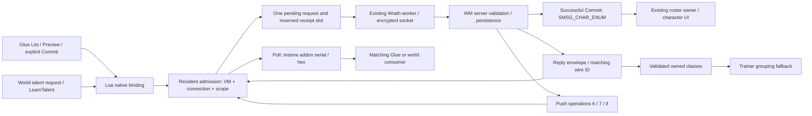

# U4 — native multiclass addon host

Source implementation, 2026-11-05. **Not compiled or runtime-accepted.**

This is the next independent package from the [release execution backlog, U4](https://github.com/Dicetar/RustWrath/blob/fa173e600d412089698a0081c15f7e41d8e3d982/docs/architecture/release-backlog-2026-11-05.md).
It restores the installed WM addon's native request/poll transport and the native
extension's trainer-grouping fallback. It does not establish full required-addon acceptance.

## Admission and branch ancestry

- Fetched `origin/main`: `46fd2f0c2af476b3659116f0fc8c95900bde95a0`.
- Base: `origin/integration/release-p0-inventory-session-2026-11-05`,
  `39e3c62a43f8967beb74c660fe3a76971d24924a`. It already includes bounded session
  delivery (`47cba73865a450218b99889cc61e392d7d4ba13c`) and lossless inventory
  (`f2c7a75a7b69b964a7019f5f194193dc3ebc6614`). Those packages were not reassigned.
- Worktree: `D:/Projects/rw-multiclass-host`, branch `feat/wrath-multiclass-host`.
  The dirty shared `D:/Projects/project-b-client` and other worktrees were preserved.
- No build/client slot acquired. No server, DB, installation, saved character data,
  extracted assets or preserved-reference files changed. No agents dispatched.

## What changed and where

| Owner / entry point | Behavior |
|---|---|
| [UI `UiScript::set_multiclass_host`](../../crates/benilla-ui/src/script/multiclass.rs) | Installs `MulticlassRequest(op, serial, guidOrTalent, class, low, high)` and `MulticlassPoll()` only on explicitly attached Wrath VMs. Numeric admission returns 1/0; empty poll returns zero Lua values. Reads the current model's session on every call, including forked VMs. |
| [Protocol `Request::from_arguments/encode`](../../crates/benilla-protocol-wrath/src/multiclass.rs) | Validates the native uint32 contract, permitted operations and token rules; emits exactly 28 bytes of WMC1 v3 payload. `WorldConnection::send` supplies the opcode and encrypted header. |
| [Protocol `ReplyHeader::decode/owned_classes`, `Request::preview_reply`](../../crates/benilla-protocol-wrath/src/multiclass.rs) | Bounds reply envelopes and validates the preview/talent data used by resident authority. Other body semantics remain the installed Lua consumers' responsibility. |
| [Resident `MulticlassBridge`, `Connection`](../../crates/benilla-app/src/multiclass.rs) | Owns admission, connection/VM/world scope, pending wire identity, timeout, preview token, replies, push queue and server-confirmed owned-class mask. No Lua socket IO or local success simulation. |
| [Worker `run_session_with_cancel`](../../crates/benilla-app/src/wrath.rs) | Dispatches on the existing authenticated parked/world connection and receives opcode `0x51a` in both loops. Existing character-enumeration handling consumes the server's post-commit roster. Drop retires the bridge on every return/unwind. |
| [Lifecycle `attach_multiclass`, `install_glue_vm`, `close_ui_session`](../../crates/benilla-app/src/ui_script/lifecycle.rs) | Attaches each seated replacement VM (not temporary strings VMs), retires pending work on closure, and executes the configured WM Glue script after stock GlueXML. Errors use existing UI load diagnostics. |
| [Trainer `resolve_service/feed_trainer`](../../crates/benilla-app/src/ui_trainer/mod.rs), [class fallback](../../crates/benilla-app/src/ui_trainer/multiclass.rs), [DBC `class_training_lines`](../../crates/benilla-formats/src/skill_lines/mod.rs) | A stock group of zero may resolve through server-owned classes. Builds candidates from the loaded class/armor/weapon skill data, follows teaching wrappers with cycle detection, and retains stock groups when present. Candidate cache invalidates when the skill-line resource changes. It never authorizes a purchase or invents a learned spell. |
| [Launcher](../../tools/launch-client.ps1) | Explicit `-WithMulticlass` requires the installed TOC and the configured Glue file; sets the extension environment for this launch. Default launches do not enable it. |

## Contract inventory and corrections to the roadmap

The local wire contract is WMC1 version 3: client opcode `0x51b`, server opcode
`0x51a`, 28-byte request, 16–4096-byte reply. The original DLL's six Lua integers
accept numeric strings, map missing/nonnumeric arguments to zero, and reject
fractional, negative, non-finite or greater-than-uint32 values. Those semantics are
preserved before request validation. Poll returns the complete reply as lowercase hex.

| Operation | Scope / authoritative outcome | Consumer |
|---|---|---|
| 1 List | Parked account roster/progression snapshot; no player loaded | `multiclass_glue.lua::receive`, character selection panel |
| 2 Preview | Parked, owned eligible offline character; 120-second server preview token | Glue preview text and second-click confirmation |
| 3 Commit | Parked, matching preview/receipt; durable server reset, then character enum | Glue receipt plus the existing roster reducer/UI path |
| 4 Talents | In world, owned class; owned mask, free points, spec, counter, talent rows | `WM_Multiclass.lua::receive`, talent UI and spellbook class presentation |
| 5 LearnTalent | In world; server validates class, spec, rank, available points and combat/alive gates | Same snapshot consumer; normal server talent/spell updates remain authoritative |
| 6 MassacreState | In-world unsolicited snapshot, request ID zero | Installed `WM_MulticlassMassacre:SetState` when present |
| 7 BonusXpState | In-world unsolicited snapshot, request ID zero; versions 1–5 understood by the installed Lua | `WM_MulticlassBonusXp:SetState`; includes one-shot notification data |
| 8 Hunt | In-world unsolicited snapshot, request ID zero, snapshot version 1 | `WM_MulticlassHunt:SetState`, including item annotations |

**New source finding:** operation 8 is emitted by
`MulticlassHunt.cpp::SendHunt` using a literal operation value. It is absent from
`MulticlassProtocol.h::Operation`, whose enum ends at 7. The installed main addon
does parse operation 8. Enumerating only the header would disconnect a valid
installed Hunt consumer; this implementation admits the source-backed eighth operation.

**Native behavior beyond API registration:**
`MulticlassClient.cpp::ClassifyTrainerSpell/FindTrainerSkill` falls back to owned
class masks when stock classification returns zero. Merely restoring Request/Poll
would still hide such trainer rows in `resolve_service`. The new fallback derives
the same class/armor/weapon candidate rules from the runtime DBC catalog rather
than copying the generated header. The server's buy response remains authoritative.

The extension has no capability-negotiation handshake in these sources. The
roadmap's word “negotiated” must not be read as an implemented handshake. Deployment
is an explicit opt-in to this contract; reply versions are checked. A matching
source file is not proof that the running world server uses it.

## State and failure rules



- One request may be outstanding, matching both installed callers. One reserved
  receipt cannot be displaced by pushes. A separate FIFO holds at most 16 pushes;
  each is at most 4096 bytes. A full receipt slot refuses another request.
- Admission 1 means queued, not sent or committed. Dispatch marks work in flight
  under the mutex, then releases it before IO. A concurrent VM retirement after
  that point cannot promise that the server did not apply the action.
- Wire IDs increase across VMs and reconnects for the lifetime of the bridge.
  Addon serials may restart; late wire replies cannot satisfy a new serial.
  Exhaustion refuses admission instead of wrapping.
- Requests expire after eight seconds of host monotonic time. There is no
  automatic replay. A sent mutation with no receipt has an unknown outcome;
  inspect refreshed server state before deciding on another explicit action.
- Successful Preview stores a token bound to its requested character and choice.
  Commit requires that current token within a conservative 120-second window
  starting at preview admission. List/new Preview clears the old token; success
  or StalePreview clears it; connection, scope and VM retirement clear it.
- Only Glue can submit operations 1–3 in parked selection. Only the active world
  VM can submit 4–5 in `Phase::InWorld`. Character create/delete processing closes
  the parked scope; entry and transfer close it too. Already dispatched work may
  have taken effect and is never represented as rolled back by a scope change.
- Logout, disconnect, cancellation and worker failure retire the lease. Explicit
  stop disables admission before joining the worker, and a stopped worker cannot
  reopen the bridge. UI reload retires correlation and previews; character-owned
  class presentation may retain its already confirmed mask within the same
  connection, but another connection starts empty.
- First-login pushes can wait for the world VM. VM/world retirement clears old
  queued work. Bonus-XP packets contain one-shot notification data, so overload
  fails the session through the existing terminal path instead of coalescing them
  or silently dropping packets. Queue adequacy during real UI load remains a gate.
- Malformed envelopes, malformed authoritative preview/talent snapshots, socket
  failure or push overflow terminate this opted-in session. Stale, valid replies
  are ignored with a diagnostic. No optimistic progression is written locally.
- Logs use `multiclass:` with operation, wire ID, VM/scope, dispatch, receipt,
  timeout and retirement. Request/reply correlation is at debug level; mutation
  receipts are info, failures are warnings/errors. Preview tokens, account names
  and raw payloads are not logged.

No save or DB migration is introduced. The server retains progression, receipts,
talents and Hunt state; the existing addon SavedVariables writer retains UI
settings. Reconnect relies on fresh list/talent requests and server pushes, not
serialized bridge queues. Turning the opt-in off rolls back client activation;
it does not reverse a server-confirmed rebirth or talent spend.

## Provenance and exact local inputs

Read-only WM root: `D:/WOW/wm-project`; installed addon root:
`D:/WOW/world of warcraft 3.3.5a hd/Interface/AddOns/WM_Multiclass`.
WM repository HEAD was `282d8f9eb1461dc6c847cd8ccd51f064e8f7351c`, **but the two
multiclass directories are untracked there**. That commit does not pin these
contracts. Their inspected SHA256 values are the relevant evidence:

| Local file (WM-root relative unless marked installed) | SHA256 |
|---|---|
| `client_extensions/multiclass/MulticlassClient.cpp` | `7A57A75A1F9BB471DA496252BEEB7AF4B8F6985CBFAECFA2123B78C066193824` |
| `client_extensions/multiclass/multiclass_glue.lua` | `A105222CF287A55DBF60AC1D74CDDC8AFF5A0BE5F92759C4D66F195DCC8B11E3` |
| `client_extensions/multiclass/Build-SpellClasses.py` | `ED6DFA36F1B68FDA6B63DD02E0FB50B98160F258C63CD855C7098760996CECE1` |
| `native_modules/mod-multiclass/src/MulticlassProtocol.h` | `B8B67F218FFB88B4EF3D3D872C56FECC7D28443E19A9A3719CC9BE56DCF508AA` |
| `native_modules/mod-multiclass/src/MulticlassTransport.cpp` | `AE6C0E8D1F3742590FCCE3735525AD86D0507ABC6B39426EF82BEEC2C38D8F30` |
| `native_modules/mod-multiclass/src/MulticlassHunt.cpp` | `0C7CD40194E7E6770E1C4B9EAC61B7558015412B7B00AF224AD77508BE6D667D` |
| installed `WM_Multiclass.lua` | `CC4B994AD01C2AB36BB206CE83FB6C3DA23412DE70C0C1C26D5866C7C5C48CC0` |
| installed `WM_Multiclass.toc` | `80D96E18A4D28DCB612AEDA415A9DC4A7B23A0D9980EF99AE82442102951355E` |

The preserved client reference remains at
`e67b6ffef23655dc7da061cb2d36b7963f6ef71a`:
`Engine/Source/FrameScript/FrameScript.cpp::FrameScript_RegisterFunction`
(`0x00817F90`) and `FrameScript_Execute` (`0x00819210`) match the native extension's
registrar/execute addresses. `WoW/Source/Glue/CGlueMgr.cpp::Resume`
(`0x004DA5F0`) flushes/registers Glue scripts before loading GlueXML. That
reconstruction contains other fork hooks; it supports the lifecycle boundary,
not independent proof of this addon's runtime. No reference implementation or
game data was copied into this patch.

## Activation and integration handoff

After a separately authorized build and session, from the built checkout:

```powershell
.\tools\launch-client.ps1 -WithMulticlass
```

`-MulticlassGluePath` overrides the default local WM source path. Direct launchers
must supply `WOW_WRATH_MULTICLASS=1` and `WOW_MULTICLASS_GLUE=<absolute file>` as
well as the normal Wrath/addon settings. The installed addon still loads through
the existing TOC pipeline. The two API names alone do not prove that its frames,
settings, event handlers, textures or gameplay integration work.

Shared-file integration conflicts are most likely in `wrath.rs` (T/A/K),
`ui_script/lifecycle.rs` (T/U), `script/mod.rs`, `skill_lines/mod.rs` and
`ui_trainer/mod.rs` (stock/UI contracts), `lib.rs` (module registration), and
`tools/launch-client.ps1` (N). Preserve the integration base's session delivery and
lossless inventory changes. Existing test constructors only gained the new
optional field; no new tests or test files were authored.

## Acceptance still required — not executed

Source inspection and `git diff --check` are the verification performed here.
No Cargo build, test, linter, type check, browser, native client or server session
ran. The following bounded acceptance set is a dispatchable follow-up **after
owner authorization**, not a record of passed checks:

1. Compile the affected workspace/client and existing trainer fixtures; confirm
   no privacy, system-parameter or Lua return-shape errors.
2. ABI boundary cases: numeric strings, omitted values, fractional/non-finite,
   over-u32, invalid operation/class/token; no socket bytes after refusal.
3. Wire fixture: exact 28-byte body, zero reserved bytes, unique wire serial and
   rewritten original serial; malformed/truncated/oversize envelopes refused.
4. Opt-in off: no multiclass globals registered by this host and no extension
   sends. Opt-in with missing Glue/TOC: launcher failure identifies the file.
5. Login and Glue load: visible panel, roster names/GUIDs, list/selection, preview
   text and second-click confirmation. Frame existence is not a visual pass.
6. Owner-driven eligible rebirth: server receipt, refreshed level/class roster,
   enter the chosen character, persisted progression after reconnect. Do not
   automate this persistent mutation.
7. Disabled, wrong ownership, ineligible, full inventory, rate-limit and stale
   preview refusals: correct Lua feedback, no local success or phantom changes.
8. World talents: owned-class tabs, points/spec and dependencies; one owner-driven
   spend plus server refusal; normal spell/talent updates agree with the addon.
9. Trainer grouping: stock group retained; class-mask 258 permits spell 635's
   fallback line 594, mask 256 does not; teaching wrappers, armor/weapon rows,
   actual deployed DBCs and an owned-class purchase agree with server outcomes.
10. Delayed replies and UI reload: reused addon serial cannot consume old wire
    reply; a forked/inactive VM cannot submit or poll active work.
11. Transfer, logout, disconnect, stop and concurrent character actions: retire
    pending work and previews; no stale send before dispatch; a dispatched action
    remains explicitly uncertain until refreshed authoritative state is observed.
12. Pushes 6/7/8: real notifications, counters and Hunt item overlays render;
    first-login buffering, queue pressure and terminal recovery are visible.
13. Lost commit reply: no host retry; user refresh/reconnect shows actual server
    state. A deliberate same-token retry within its valid scope relies on the
    server's idempotent receipt, not client mutation reconstruction.
14. Combined installed addons, reload and reconnect: multiclass settings remain
    character-isolated; baseline bank/inventory/session changes still operate;
    no competing socket or baseline protocol regression.

Remaining product/release work: approve and distribute a versioned WM/addon/Glue
bundle (these local untracked files are not a release manifest), confirm the
running server's contract, finish U1's complete addon API/asset/error inventory,
and prove installation/upgrade/rollback delivery of the Glue file. No performance
target or live compatibility result is inferred from the queue bound or this commit.
