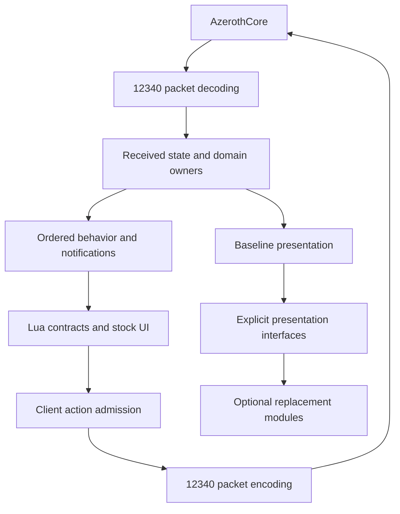

# RustWrath 12340 behavioral port proposal

Status: Proposed for owner review

Date: 2026-11-03

## Purpose and recommendation

Use the preserved WoW 3.3.5a build 12340 decompilation as the primary behavioral blueprint for RustWrath. Reimplement original contracts and connected execution paths closely, adapting their ownership and platform dependencies to Rust and Bevy. Keep a limited, explicit set of extension boundaries for the systems the owner wants modular.

Port and integrate one connected subsystem at a time. Do not postpone integration until every original function has a Rust counterpart. This proposal does not supersede an existing ADR or authorize a wholesale rewrite.

The intended outcome is a complete usable client. A translated function, compiling subsystem, or matching API name is evidence of progress but does not by itself establish original behavior.

## Existing foundations and constraints

RustWrath is a benilla-derived Rust and Bevy client targeting the owner's AzerothCore server. Its donor targets 1.12.1. Existing implementations are reusable when their behavior matches the Wrath contract; shared names and numeric similarities are insufficient evidence.

The preserved reference is `D:/Projects/wowdecomp-reference`, pinned to `e67b6ffef23655dc7da061cb2d36b7963f6ef71a`. It is reconstructed source and may contain incomplete or uncertain behavior. Selected client assets and original runtime behavior settle ambiguities; matching server source helps establish packet contracts.

The server owns authoritative gameplay state. The resident client owns received state, session and entity identity, clocks, input and GPU resources. Existing ADR-0002 defines presentation replacement through explicit interfaces; it does not make arbitrary client code safely reloadable.

The first delivery remains the login and character workflow followed by Firna's playable Northshire route. Full client coverage is the broader objective. This proposal does not redefine the first delivery as completion of the whole client.

## Meaning of one to one

Behavioral correspondence is the default. Preserve argument validation, return shapes, field widths, flags, calculations, state transitions, side effects, event ordering and lifecycle boundaries. Include failure and empty-state behavior.

Function correspondence is useful for traceability, but one original function may map to several Rust operations, and several original functions may map to one existing owner. Such mappings must retain their combined behavior. Reproducing original memory layouts, allocation patterns or engine objects is required only where an external format or interface depends on them.

| Concern | Default direction | Evidence needed for an exception |
| --- | --- | --- |
| Packets and serialized formats | Match 12340 layouts and limits | Versioned extension contract or confirmed source error |
| Gameplay and character calculations | Preserve original inputs and formulas | Explicit owner-approved feature change |
| Lua API and events | Match validation, result shape, state visibility and ordering | Explicit compatibility exception |
| Equipment and appearance | Preserve selection and composition rules for the selected assets | Confirmed asset-specific extension |
| State ownership and scheduling | Adapt to existing Rust owners while preserving ordering | A demonstrated ownership or dependency problem |
| Windowing and GPU services | Reuse working infrastructure through behaviorally equivalent adapters | Missing capability or demonstrated mismatch |
| Modular presentation | Use explicit interfaces under ADR-0002 | A separately defined new seam |

## Proposed component boundaries

### Protocol and formats

Decode complete source-version structures before projecting them. Preserve unknown or unsupported required semantics as explicit gaps rather than dropping them silently. Keep codecs independent of clocks and scene mutation.

### Received state and domain owners

Maintain one owner for each state domain. Extend its model when Wrath requires additional information. Avoid parallel authoritative copies introduced solely to bypass donor limits. Received server state, local prediction and UI projections must have distinguishable responsibilities.

### Behavior and notifications

Reconstruct the original producer, state mutation, notification and consumer chain together. A final-value snapshot can lose intermediate changes that matter to consumers; document and preserve required ordering rather than assuming frame-level coalescing is equivalent.

### UI compatibility

Keep stock FrameXML and Lua behavior as the baseline where applicable. Implement the underlying data and operations behind bindings. Constants, nil returns and no-ops count as implemented only when those are the original contract for the represented state.

### Presentation and extension interfaces

Separate baseline behavior from optional replacement policy at selected seams. Keep session state, identity and resource lifetimes in the resident host as described by ADR-0002. A module must receive explicit inputs and have defined output validation and activation behavior. A Bevy plugin boundary alone is not a stable native reload interface.

## Data and control flow

This diagram expresses responsibilities, not a requirement to introduce a new event bus or replace existing scheduling machinery.

## Why this direction could help

Close behavioral correspondence reduces repeated guesses about Wrath contracts and provides a common review language. It can make bounded delegation practical: a contributor can own a complete path with original entry points, dependencies and expected outputs.

Recent source findings illustrate the need. The donor geoset rule left Wrath eye and belt groups visible. The snapshot adapter updated health and loot flags without all required consumer notifications. These are examples of missing behavioral relationships, not evidence that every donor implementation should be discarded. Source repairs for these findings still require runtime acceptance.

No measured schedule comparison currently establishes that this approach is faster overall.

## Criticism and risks

### Translation can preserve reconstruction errors

The reference is not infallible. Trace callers, registered bindings, data layouts and side effects. Resolve uncertainty with selected assets, matching server contracts or original-client evidence. Record unresolved assumptions rather than filling them with plausible behavior.

### Literal translation can duplicate existing systems

A second original-style object manager beside the existing entity and state owners would create competing lifetimes and stale state. Map behavior onto existing ownership before adding infrastructure. Replace a working owner only when a demonstrated requirement cannot be represented coherently.

### Broad modularity can erase the expected savings

Redesigning every subsystem while porting it increases the number of simultaneous unknowns. Keep an explicit exception list. New interfaces need a concrete extension use case, state owner, lifecycle and compatibility contract.

### Bulk integration delays discovery of failures

Compilation cannot prove that event consumers see the right values at the right time. Port complete paths and integrate them immediately. Preserve a runnable baseline through incremental changes.

### Full coverage includes peripheral behavior

The original client contains many branches beyond the first playable route. A function inventory must not turn all branches into equal-priority work. Finish the agreed owner workflow while retaining a visible inventory of broader gaps.

## Migration method

1. Choose a bounded subsystem and its user-visible outcomes.
2. Identify original entry points, dependencies, state owners and consumers.
3. Map existing Rust implementations as equivalent, needs adaptation, missing, or deliberately replaced.
4. Define the required behavior and explicit architectural exceptions before editing.
5. Port connected behavior into the existing owners, including notifications and teardown.
6. Perform authorized focused checks and exercise the original visible symptom.
7. Record remaining branches and evidence limits before advancing the subsystem's status.

Avoid dual implementations that remain active indefinitely. A temporary bridge needs an identified loss and a condition for removal.

## Suggested implementation order

| Slice | Connected work | Completion evidence |
| --- | --- | --- |
| Login and character lifecycle | Authentication, realm selection, roster switching, create and cancel, Enter World, logout | Owner completes the full workflow without automatic unintended selection or stale state |
| Character and unit presentation | Class and equipment inputs, model parts, textures, attachments, health events, unit frames, nameplates, paper doll | Owner sees correct appearance and live changes without reselecting or reopening |
| Northshire quest route | Greeting, details, acceptance, objectives, POI and tracker state, turn-in and rewards | Owner completes the selected route with correct visible state |
| Combat and loot | Movement ownership, actions, auras, damage state, corpse loot and visual cleanup | Owner-driven combat and looting demonstrate state and presentation agreement |
| Broader client parity | Inventory, vendors, progression, social and other required systems | Subsystem-specific scenarios and original-contract comparisons |

These slices have dependencies and may overlap in execution. Maintain distinct file ownership and one Cargo coordinator. Do not create competing client sessions or builds.

## Completion and progress measurement

Use separate measures for original-entry-point mapping, source implementation, compilation, focused behavior checks and demonstrated runtime workflows. Do not collapse them into a single percentage without a defined denominator and weighting.

An inventory entry should identify the original behavior, Rust owner, dependencies, status, exceptions and evidence. A name match or stub belongs in the inventory but does not count as behaviorally complete. Functions supplied equivalently by infrastructure should count through their required contracts rather than through copied bodies.

The earlier 58.4 percent Lua-name overlap is a search result across a limited registration pattern and source directory. It is not a project completion estimate and should not be used to predict remaining work.

## Relationship to existing decisions

ADR-0001's lossless version-aware contracts and existing domain owners remain compatible with this proposal. The proposed change is greater systematic use of the 12340 function and dependency inventory, with closer behavioral reconstruction as the default implementation method.

ADR-0002 remains the authority for the existing live presentation interface. Additional modular systems need their own explicit contracts; this proposal does not authorize crossing Rust or Bevy internal objects through native interfaces.

## Decision requested

Adopt close 12340 behavioral reconstruction by connected subsystem as the default, retaining equivalent existing implementations and limiting architectural deviations to explicit reviewed exceptions. Decide separately whether eventual retirement of the donor 1.12 mode is desired; this proposal preserves the current version boundary.

## Sources

- `CONTEXT.md`
- `docs/agents/12340-reference.md`
- `docs/architecture/adr-0001-wrath-compatibility-boundary.md`
- `docs/architecture/adr-0002-live-client-modules.md`
- Preserved 12340 reference at the pin stated above
- Current character geoset, section-loader and snapshot-adapter source investigations
