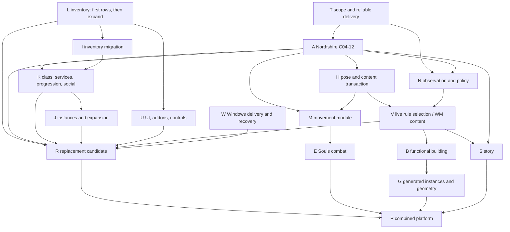

# RustWrath implementation dispatch and release gates

Read the [review pin and repair dispositions](release-review-2026-11-05.md), then the [family traces](release-matrix-2026-11-05.md) for the package's F IDs. This backlog is for two workers and one supervisor. A package owns a complete behavior across the files it needs. Dispatch **one listed child slice at a time** within each worker slot. A package with several children remains open until its children and family inventory are closed. All named symbols below exist unless **proposed**. Proposed names specify where a responsibility belongs; first look for an equivalent current owner at dispatch.

## First executable batch

|Who|Start from the reviewed main SHA|Return before release of the reservation|
|---|---|---|
|Worker 1 · **L1**|Own issue 18 and its ledger only. Diff the current `ClientCommand` producers vs `wrath_tap_commands`, then compare `gameplay::parse` arms against AC `Opcodes.cpp`. Start with pet order, talent spend, bank upper slots, LFG join and calendar fetch from F06–F13. Each is a named, independently observable child, even when both wire directions are absent.|Ledger with positive/control case, first broken edge, existing branch/repair, accountable package, refusal/reconnect/persistence case and evidence locator per row. Give I the list of affected read/write addresses. Do not edit `wrath.rs`.|
|Worker 2 · **T1**|Own the Wrath reliable session-reply and lifecycle queues in `WrathControl::start`, `WrathFeed::push_event`, `take_session_events`, `wrath_net_drain`, `wrath_dispatch_events` and worker shutdown. Use local G06-02/G06-03 tickets. Map the two existing lanes and terminal delivery before changing either.|A bounded, ordered handoff with reserved termination/transfer and a deterministic full-queue policy. Hand back the precise scope/order contract, changed call sites and the slow-consumer/disconnect cases still needing permission to run. No UI, bank, WM or module refactor in this slice.|
|Supervisor|Fetch; compare parent SHAs/dirty diffs against this pin and [active ownership](../agents/active-ownership.md). Reserve explicit files/regions and an integration order. Attach the prior G01 journey, G06 tickets and November 4 log handoff; ask the owner for D1–D6 in parallel with source work.|Own shared-file merge, evidence identity and Cargo/client scheduling. Authorize no runs on the basis of this planning document. No imports from local repairs until reviewed with their owner. Stop dispatch if a named repair landed in the meantime.|

**Admission and handback for every child.** Record base commit, branch/worktree, external repo and pin where relevant, touched files/functions, existing repair comparison and actual scope. A proposed function becomes a symbol only in an implemented patch. Attach the before/after trace and observations at the layers actually checked (source, compiled, focused case, receiver, visible result, durable re-read). Mark a remaining required check **pending**, preserve its exact scenario, and retain failed evidence. Completion below means release acceptance, distinct from source ready for review. Credentials and combat remain owner-driven; external WM/server edits, deployment and persistent test-character operations require their own assignments. Do not take a build/client slot from another session.

## Dependencies and two-worker sequence

This is a dependency graph, not a calendar estimate. **Replacement has two gating chains**: T → A → K → J and T → A → H/N → V, joined with completed L, I, U and W at R. **Platform must retain R** and close H → M → E, V + spatial decision → B → G, and V + authoritative quest state → S before P. Without measured durations an elapsed-time longest path cannot be identified. The graph groups internal milestones: C04→C05/C06, C05→C07→C08, C06+C08→C09→C10→C11/C12. C01/C02 can proceed from a real scoped world snapshot; only C13 needs C10. Spellwright validation C14 can precede H/N; **V completion** includes C15 and C17, which require the other inputs.

|Dependency-ready batch|Worker 1|Worker 2|Supervisor join|
|---|---|---|---|
|1|L1 first inventory|T1 reliable handoff|Reserve `wrath.rs` for T.|
|2|A1 profile/terrain/body using C04–07; no shared tap edits while T owns it|T2 terminal receipts and recovery, compare recorder repair|Integrate T first; coordinate A1 projection hunk if needed.|
|3|A2 correction/travel → A3 baseline combat/quest/death|I1 typed bank view outside tap, then I2 wire addressing after A releases it|Single owner drives an authorized alpha session. Any earlier fix is evaluated against its symptom.|
|4|K children F05–11; serialize command/decoder changes|U stock UI and addon children, then N receiver/context first|Together close C01/C02; C13 uses accepted C10. Continue L enumeration as each child enters.|
|5|J queue, instance and expansion children|H pose health and local content adoption|Resolve D2/D5 trust/maintenance before WM remote activation.|
|6|V live selection/rollback and WM distribution|W release assembly and migrations|Run R gates only when L and all mandatory rows are closed. W design/clean install work may start earlier without contending for a runtime slot.|
|Platform after alpha as staffing permits|M then E; later S|B then G; S may use the first free slot after V and A|Do not displace the remaining replacement gates. P needs R and all platform outcomes.|

## Package contracts

Existing focused source cases give workers a starting point for regression analysis. `wrath.rs::terminal_scope_loss_clears_ecs_and_input_without_a_digest` covers one T teardown; `reducer.rs::values_update_changes_only_masked_fields` and `guid_survives_destroy_and_recreate_with_a_generation` constrain I; `gameplay.rs::quest_details_reads_the_12340_tail` and `inventory_failure_keeps_both_item_guids` constrain A/I; `benilla-hotpatch/src/lib.rs::poll_retries_unchanged_manifest_after_transient_load_failure` constrains H. These are source locators, not current pass results. None exercises a crowded connected client through rollback.

### L · Full replacement inventory (C03; F01–F17)

* **Inputs → outputs.** Approved §8, AC opcode registrations/status/handlers, original script registrations + selected FrameXML/GlueXML callers, profile dependency chains, actual addon manifests, owner workflow → versioned issue 18 behavior rows. L1 covers producer/encoder/decoder gaps. L2 enumerates UI, format and addon paths. L3 reconciles the remaining child lists in every F row, including configured-off server capabilities.
* **Work.** Compare `wrath_tap_commands`, `translate_gameplay`, `gameplay::parse`, `SessionState::reduce`, actual host registration and consumer system. For each unmatched symbol decide unused, donor-only, server-disabled, variant or required missing operation with a cited reason. Split multi-operation opcodes and nil-return APIs into observable outcomes. Key rows by family, action, variant and scope, link C ID/current owner/scenario. Keep the ledger appendable when new behaviors emerge; freeze only after comparison against every source list.
* **Invariant / migration / conflict.** Retain issue IDs and historical evidence; migrate October labels through explicit supersession, never renumber by percentage. Own inventory docs only, route implementation to domain owner. Unavailable cases stay open. **Done** when every source list reconciles in both directions, required versions are pinned, and supervisor can dispatch and audit every required row without a chat transcript.

### T · Scoped handoff, cancellation and recorder (F01/F04/F17)

* **Inputs → outputs.** Worker events, dense snapshots, reliable replies, native observations, player commands, terminal signals → bounded class-specific transport and observable terminal status. Use existing receipt contract for quest click as the reference interface. T1 above; T2 covers parked/login/pick, publish-retirement, WM action/cancel/result and shared command ingress using the existing G06 inventory; coordinate with N.
* **Function changes.** In `WrathControl::start/stop` and `run_session_with_cancel`, establish per-session channel lifetime. In `WrathFeed::push_event`, `take_events/take_session_events`, `wrath_net_drain/wrath_dispatch_events`, partition reliable edges, latest-only snapshots and replaceable movement. Record high-water, queue age, oldest scope and individual refusal. **Proposed** `retire_scoped_delivery` completes outstanding receipts and publisher handles once at the barrier. Compare `History::export/export_sync` and local writer guard separately for overlapping manual save, exit and failed thread spawn.
* **Invariant / migration / conflict.** No render-thread blocking, unbounded spill queue, or silent loss of irreversible edges. A full lane explicitly refuses a new action or terminates and resynchronizes the affected scope; shutdown bypasses stalled consumers without reordering accepted actions. Preserve old command API and donor callers. Reserve app/wrath.rs, net/io and recorder in sequence with A/I/N/H. **Done** when full queue + transfer + cancel/reconnect finishes, stale packets cannot mutate new state, quest/loot/cast have one terminal status, and interrupted export can be retried with correct provenance.

### A · Playable Northshire vertical (C04–C12; F01–05/F09–10)

* **Inputs → outputs.** Pinned base/wm-hd profiles, authorized character/server and current login/route handoffs → one identified candidate/session covering auth, actor, correction, quest, combat, loot, XP, death and reconnect. **A1** follow login `wrath_login_admission/wrath_pick_admission`, parked roster, `open_profile_chain`, collider completion, `build_digest/wrath_apply_world`, `spawn_slot`; resolve actual body/attachment/material/audio consumer on the two profiles. **A2** `controller::control` → `wrath_stream_movement` → correction and transfer; guard stale scope. **A3** follow F05/F10 and surface refusal, metadata arrival, XP field/bar and authenticated outcome at first failing edge.
* **Invariant / migration / conflict.** Keep profile source identity per asset, displayed position tied to entity generation and rewards tied to server mutations. Repair only the first contradicted edge; migrate actual readers from narrowed projections where needed. Reserve `wrath.rs` after T, coordinate I and K. Retain earlier quest-tail, trainer, display and pet fixes. Missing asset or timeout leaves a visible reason and recoverable panel/session.
* **Done** when owner enters Firna, checks equipping/sheathing and lighting, walks Northshire to the Elwynn boundary including the approved ten-minute route, chats, accepts/advances/rewards Kobold Camp Cleanup, loots a named item, observes award/bar, dies/releases/recovers and reconnects with matching character state. Pair NPC/object alias, packet/result, pixels and persisted inventory. Set route/correction tolerances before measurement. Alpha alone closes neither release.

### I · Lossless inventory and service transactions (F07)

* **Inputs → outputs.** Delivered player/item/container masks + object generation, true 12340 slot identifiers, templates → inventory view and encoder that address the same item in both directions. **I1** use `reducer.rs::apply_values/field_delivered`, `apply_item_world`, `push_player_inventory_fields/push_item_fields`. **Proposed** `apply_wrath_inventory_delta` tracks typed player/container/slot, GUID, known/cleared state and incarnation. **I2** replace donor address assumptions in `wrath_item_pos/wrath_bank_bag` and real readers `ui_bank::feed_bank`, bag queries, item operations and tooltips. **I3** migrate vendor, trade, mail and auction flows one independently observable transaction at a time, using `ui_trade/net.rs::on_trade_status_extended`, `ui_auction/verbs.rs::place_bid` and their Wrath producers or missing dispatch.
* **Invariant / migration / conflict.** Missing sparse field ≠ zero; clear ≠ item metadata pending. Index by session, incarnation and owner. Compare translated and typed outputs on overlapping slots, switch readers successively, remove projection only after last reader. No server DB migration for client projection. T/A/K/J all touch the tap; reserve by turn. Timeout after write is unknown: refetch server balance/item before retry; preserve prior server IDs.
* **Done** at slot 25–28, seventh bag, clear/recreate, split/stack, two-party transaction/cancel, insufficient funds, delayed template and reconnect. Release still requires every remaining F07 child, including guild repair, COD/return/buyback and auction expiry.

### K · Baseline character and multiplayer workflows (F05/06/08/09/11, service dependencies F07)

* **Inputs → outputs.** AC spell/pet/talent/trainer/social handlers, source ledger, I inventory wire view → admitted normal verbs and scoped recipients. Dispatch children separately: **K1** pet attack/follow and refusal; **K2** talent spend/refusal and spec/XP; **K3** learn/gather/craft, materials and repeats; **K4** social membership/loot; **K5** remaining class/pet/progression mechanics discovered by L. Match each missing command arm with a receiving state owner before adding any binding.
* **Functions.** Extend `ui_pet/drain.rs::finish_press`, `ui_talent.rs::apply/feed_talents` through the existing tap. **Proposed** `encode_pet_action` and `encode_learn_talent` in Wrath wire using the pinned AC request layouts. Route validated bar/spellbook/rank results to existing owners; compare original Lua positive and empty signatures. Use `open_trade_skill/do_trade_skill/reset_crafts_on_world_enter`, `friend_rows/who_rows` and `read_loot_roll_won` for their respective consumers. Reuse `wrath_native.rs::apply/invalidate_scope` and `wrath_power_feed.rs::feed` where they already own state.
* **Invariant / migration / conflict.** One writer per pet bar/book/rank/membership, no local debit/award for a rejected action. Keep target-specific behavior at the wire adapter, switch donor consumers individually and compare before retiring shims. Transient repeat/target/pending invite retires with scope; durable data comes back from server. Reserve tap/codec with I/J and group UI with U. **Done** for each independently enumerated action with a normal, refused, switched-target/transfer and reconnect result, verified on receiving peers for social and loot; F05/06/08/09/11 must all close at R.

### J · Dungeon, PvP and Wrath-only workflows (F12–13)

* **Inputs → outputs.** F12/F13 inventory, AC LFG/BG/calendar/achievement/vehicle handlers and original UI scripts → scoped typed stores and real user actions. **J1** LFG join → role → proposal → transfer → lockout; AC `HandleLfgJoinOpcode/SendLfgJoinResult` vs `UI/wrath_natives.rs` aura queries. **Proposed** `apply_queue_status` only after locating any existing queue owner. **J2** battlefield/arena entry, scoreboard and objectives from the server. **J3** calendar invite/response via `HandleCalendarGetCalendar`; marshal it into the actual frame callbacks. **J4** DK/runes, vehicles/seats, achievements and phasing, one receiver-visible child each. Reuse `SessionState::reduce/worldport_acknowledged` and action bar/movement owners.
* **Invariant / migration / conflict.** Retain stable IDs, rights, timers and instance scope; distinguish absent data from an empty result. Replace constant/empty UI answers only with a real producer. Retire expired proposals on decline/disconnect, re-read lockouts/events at re-entry. Coordinate tap, opcode table, world teardown and Lua registry with K/U. **Done** when queued and unqueued outcomes, refused join, remote player views, vehicle exit, phase change, achievements and server calendar survive their appropriate reconnect lifecycles. Document server-disabled variants for owner disposition.

### U · Stock UI, controls and addon compatibility (F14–16)

* **Inputs → outputs.** Stock glue/world callers, required TOCs and real addon workflows → mode-correct Lua answers/events backed by actual state. **U1** inventory exact load failures (first cause before reporter cascades), load order, secure/in-combat rules and SavedVariables. **U2** `install_wrath` → `addon_whisper` → targeted chat → `read_message_chat` and addon event. Exercise WMBridge fallback, multiclass/Spellwright and installed `WMQuestieCompat.lua::patchQuestie` with Questie. **U3** `bindings/store.rs::to_diff/from_diff/resolve`, `ui_action/drain.rs::set`, `read_action_buttons` and `run_pending_reload`: action pages, controls/macros/settings and character isolation.
* **Invariant / migration / conflict.** Preserve legitimate empty/nil/arity vs unsupported behavior. Keep account/character files, load-on-demand dependencies, UI generation and protected-state rules. Backup before migrating saved formats; validate and restore last compatible files on failure. Own registry and Lua consumers; changes to tap serialized with T/K, VM lifecycle with H. **Done** when every stock caller in L and every pinned addon passes its positive and refusal workflows alone and in combination through UI reload/relogin. Record error filename/line, native source and visible outcome.

* **U4 required multiclass extension.** Match WM `MulticlassClient.cpp::RegisterApis`, `multiclass_glue.lua`, installed `WM_Multiclass.lua::request`, `MulticlassProtocol.h` and `MulticlassTransport.cpp::CanPacketReceive/Send`. Implement the existing addon-facing names `MulticlassRequest` and `MulticlassPoll` in the fork. **Proposed** `encode_multiclass_request` and `accept_multiclass_reply` enforce negotiated WMC1 v3, limits, operation, scope and serial; keep bounded replies in a resident session owner across asynchronous delivery, expose only to the matching glue/world consumer. Expire stale previews and pending serials on transfer or VM retirement. Never send extension opcodes in baseline; no injection or patched original executable required. Prove list/preview/commit/roster refresh, talent request/refusal, lost reply and relog; enumerate MassacreState and BonusXpState with the pinned server. Coordinate glue parking with T/A, codec with K, addon toggles with N.

### N · WM observation, control and fallback (C01/C02/C13)

* **Inputs → outputs.** Current session/world/observation revision, expiry, capabilities, action request ID → consumed WM context, admitted ordinary action and terminal result. **N1** trace `SessionState::export` → native `publisher.rs`, `client.rs::send_and_ack` → WM `wm_native/runtime.py::NativeObservationRuntime.start_from_env/fallback_loader` and `wm/context/builder.py::ContextPackBuilder.build_for_target`. Verify which loader the running autoplay service actually injects. **N2** `submit_action`, `poll_peer`, `wrath_wm_action_intake`, `route_wm_action_outcomes`, `send_action_result`; distinguish admission, write, server-confirmed, refused and unknown. Use existing `wm_native/actions.py::ActionBroker`.
* **Invariant / migration / conflict.** WM owns policy, AC owns effects; only one transport runs a given intent. Idempotent request ID scoped to session and expiry. No extension packets in baseline; preserve DB/SOAP fallback and human override. Preserve successful records on schema extension. Timeout or transfer before result is unknown, consult authoritative state, never replay blindly. Reserve publisher/tap with T/V, external WM under its own assignment. **Done** with real receiver uptake in context, stale/expired observation, lost ACK, player override, disconnected receiver/fallback, reconnect and exactly one outcome on peer and host. A headless driver alone cannot close C01/C13.

### H · Local module health and coherent content/UI revisions (C16, pose prerequisite to M)

* **Inputs → outputs.** Trusted ready manifest/digest, profile and dependent catalogs/GPU/UI, ABI capabilities and quiescent boundary → activated revision or explicit retained/rolled-back predecessor. **H1** review local repair for `Host::poll/evaluate`, `Loaded::open`, Bevy `apply_pose/restore_pose`, `tools/publish-pose-module.ps1`. Validate host rig spans before moving active/history; reject malformed output without writing a partial rig. **H2** `Profile::reload`, `ProfileAssetReader::reload`, `run_pending_reload`; **proposed** `stage_content_revision/commit_content_revision` resolve all dependent handles, catalogs, shaders, loose/archive/VM inputs and saved-state compatibility. Prepare isolated candidates and publish at one safe frame/reload boundary.
* **Invariant / migration / conflict.** Current local SHA-1 identity checks do not authenticate remote code. Hold referenced old libraries/assets until readers and frame callbacks drain; restore prior render locals, UI data and handles on failure. Keep authoritative casts/quests in host across VM generation. No raw Rust/Bevy objects across DLL boundary; trusted native crash needs out-of-process last-good startup, as an access violation cannot be caught by descriptor checks. Track visible asset revision, reject mixed caches, rollback schema-compatible settings. Reserve ADR/host/adapter and lifecycle after T/U, stage WM changes in V.
* **Done** at same PID A→B→A with visible pose and visible asset/stock UI change, invalid dependency/ABI/digest/host frame/VM failure, failed predecessor, disconnect during activation, explicit disable/unload and cold recovery. Retain prior usable revisions under the existing retention policy. Demonstrate a real rig and current model/palette/texture, not a changed file on disk.

### V · Live WM rules and client publication (C14/C15/C17)

* **Inputs → outputs.** Versioned immutable graph, logical action binding, receiver capability, client manifest, authenticated publisher + dependency list → per-client revision/result and server-selected behavior. **V1** use [Spellwright contract](../live-rules/B-001B-1-contract.md) and actual `SpellmakingV3.cpp::Command/Purchase/Configure`; online actor/maker/ingredients, quote nonce, fee and DB transaction matter. Acquire external owner for any missing typed command adapter. **V2** **proposed** `activate_definition/pin_instance_revision` in existing WM/control + server selection owner; bind logical action to A or B separately from purchase. **V3** negotiate manifest, stage in H, ACK actual activated revision to WM, handle client behind/unsupported.
* **Invariant / migration / conflict.** An old cast/aura continues on its original revision; deleting B terminates its instances in existing DELETE semantics, so rollback switches future selection back to A and drains B before retirement. Never reuse a retired carrier/ID while referenced. Journal immutable IDs, grants, rollback pointer and client compatibility transactionally; verify prior schema remains readable. Baseline has no WM dependency. On partial publish retain prior revision and reconcile clients by ID, recover pending transaction after restart. WM/native publisher + H + U reservations, no external deployment by implication.
* **Done** on running server/connected clients: revision A running, publish B, initiate B, old A completes correctly, rollback to A, duplicate delivery/late client reconnect, explicit unload/retirement, no duplicate purchases or grants. Routine supported changes require no server/client rebuild/restart; UI may use /reload. Separately rehearse declared maintenance recovery.

### W · Windows installation, update and recovery (F17)

* **Inputs → outputs.** `Launch RustWrath.cmd`, `tools/launch-client.ps1`, profiles, lockfile, addon corpus, diagnostics/export, coupled server/schema requirements → a relocatable versioned candidate and recoverable installer/updater. **W1** separate user data/config/logs from immutable version directories; discover/validate owner-provided game data and offline dependencies. **W2 proposed** `stage_release_set`, `activate_release_set`, `recover_release_set` in the chosen delivery tool; verify trusted manifest, file hashes, disk space, signatures/compatibility policy, previous pointer and backups before an atomic selector switch. **W3** retain previous version through health check and record crash-safe migration steps.
* **Invariant / migration / conflict.** No game data redistributed, no credentials in receipts. Copy/validate before changing active config, SavedVariables, binding/profile layout or WM schema; keep known-good data or reversible journal, separately preserve server character progress. Never downgrade a live DB blindly. Old install stays usable; missing data prompts for a path and failed upgrade leaves a route back. Own launcher/distribution only, coordinate profile manifest with H and external schema with V. **Done** at each Windows release gate below, including offline repair/rollback on the target machine without Cargo or a source checkout.

### M · Swappable movement (platform; after alpha and H)

* **Inputs → outputs.** `MovementModuleV1`, copied per-frame position, controls, terrain/liquid and approved capability → validated intent for `player/controller.rs::control` and one `wrath_stream_movement` writer. `Loaded::open` today is pose-kind; **proposed** `stage_movement_processor/evaluate_movement_intent` choose movement entry, check kind/version/layout/output bounds and reject unsafe flags/opcode/speeds. Produce a baseline adapter and a demonstrably different optional adapter. This second caller justifies extracting shared loading/retention.
* **Invariant / migration / conflict.** Host owns clock, sockets, input, correction, locomotion continuity and library lifetime. Pin an in-flight motion until safe tick or reconcile to server, deactivate at quiescence and hand prediction to baseline exactly once. Migrate velocity/pose explicitly or reset to authoritative snapshot. No persisted module pointers. Reserve hotpatch host ABI after H and controller/wire writer after A/T. **Done** at same-PID baseline→alternate→baseline, forced correction, mid-fall unload, missing dependency, failed candidate, reconnect. No duplicate movement or stale callback.

### E · Server-authoritative Souls combat (platform; M, D3)

* **Inputs → outputs.** Movement proposal, target, encounter revision, server clock/sequence and eligible attack class → authoritative resource, hit/avoid, animation/telegraph and combat log visible to both peers. Local `D:/Projects/project-b-opencode/crates/benilla-combat-core` has `CombatCore::submit/advance_to/snapshot/reconcile` as an offline model. `combat_mode.rs::request_experimental` currently refuses. **E1** negotiate capability and one dodge vs telegraph with half-open server windows and receipt ordering; **proposed** `evaluate_combat_intent/apply_authoritative_combat_result` bridge `CombatModuleV1` to the existing AC combat owner. **E2** add lock-on, roll/block/parry, stamina/poise, hit/cancel windows and animation per agreed encounter; trace melee, direct/periodic/shared/environmental damage, procs/threat/shields.
* **Invariant / migration / conflict.** Module never spends stamina, deals damage or asserts a hit. Host bounds outputs; reconcile on refusal/latency. Pin revision through running attack, settle timers once on death, disconnect or mode exit, drain before unload. Persist only authored revision/authoritative encounter state per D3; refuse incompatible peer and default to baseline. Reserve movement/combat seam after M, server spell hooks with V. **Done** when peers agree on avoid/hit, debit, death, disabled fallback and reconnect while baseline class combat remains playable.

### B · Functional building (platform; V, D1)

* **Inputs → outputs.** Authorized actor, item cost, footprint/orientation, phase/map and supported model → ghost preview, idempotent placement request, AC-persisted structure ID, interaction plus collision and traversability. Use WM `ExecuteWorldSpawn`, AC `Map::InsertGameObjectModel` and client `terrain_stream/collider.rs::placement_collider_data`. **Proposed** `preview_placement/request_placement/commit_placement` validate rules at the server, apply debit/spawn atomically or journal compensation. **B2** removal, ownership, support, use/interaction and nav invalidation under D1. Keep preview local until confirmed.
* **Invariant / migration / conflict.** One placement ID across inventory, collision/LOS, nav and persistence. Reject invalid footprint/rights without debit; retries reconcile committed state. Store schema/model/footprint revision and migrate old structures or pin prior data. Unload preview/interaction processor only after resolving pending placements; committed structures remain server-owned. Reserve WM spawn, allocator and map/nav owner with G/E. **Done** when two players use/remove the same structure, player/mob/playerbot take the correct path around it, reload/reconnect and server recovery preserve state. Decorative placement fails this gate.

### G · Generated spaces, content and durable instances (platform; B, D1/D4)

* **Inputs → outputs.** Pinned build/catalog/seed, occupancy, content/geometry dependencies → matching rendered terrain, authoritative collision/nav, instance lifecycle, spawned mobs/decorations and durable item rewards. **G1** `artifact.rs::Candidate::{capture,encode,decode,restore}`, `EncounterPlan::build/verify`, `WmDraft::build/verify`, application/cleanup receipts → WM `run_bundle` on existing terrain. **G2 proposed** `publish_instance/resume_instance/retire_instance` bind stable IDs and journal prepared/applied/unknown/removed steps by instance/revision. Map `ItemContentPlan::build` through existing WM allocator and validated template/display mappings. **G3** `SpaceModuleV1` produces bounded candidate descriptors; pair authored ADT/WMO/DBC manifest with server map/vmap/mmap generation or accepted runtime strategy.
* **Invariant / migration / conflict.** A replayed seed alone is insufficient: pin generator, catalog, placement IDs and revision. WM/server allocate and own spawns, collision, rewards and cleanup; export/import provenance, idempotent retry with no double drop or ID reuse. Preserve old artifacts and active instance journals, migrate schema or pin until drained; on partial publication compensate only known owned IDs, reconcile unknowns before continuing. Explicit unload stops new instances and leaves old ones pinned/resumable. Reserve WM/AC spatial files with B and item allocator with I/V. **Done** when an existing-map encounter and a genuinely generated traversable space each survive reconnect/restart, have matching geometry and NPC/playerbot navigation, dynamic mobs/decorations/items, cleanup after failure, and exactly-once rewards. Layouts alone close G1 only.

### S · Hot-swappable branching story (platform; A, V)

* **Inputs → outputs.** Story revision, stable story/step ID, actor/party and authoritative quest/world facts → validated requests to existing WM quest/AC reward owners. `StoryModuleV1`, `wm/quests/validator.py::validate_bounty_quest_draft`, `ContextPackBuilder.build_for_target`, app `QuestVerbs::accept` and `ui_quest/net.rs::on_complete` are distinct entry points. **Proposed** `evaluate_story_transition` selects a validated transition; server/WM applies an idempotency key for branch and reward. Return updated quest state to the normal journal/UI.
* **Invariant / migration / conflict.** Validate graph reachability, dependencies and reward/ID references before activation. Pin in-flight branches, persist actor/party milestone and grant key, or apply a reviewed migration map; reject dangling steps. On lost acknowledgement re-read journal instead of issuing another reward. Retire module when old instances drain, baseline quests continue when disabled. Reserve WM revision selector with V and quest UI with A. **Done** when two branches can be reached, an active player crosses publication/rollback, reconnects to the correct branch and receives one grant, including unload while a quest is active.

### R and P · Release integration and rollback

* **R inputs → output.** Frozen L, A/I/K/J/U/N/V/H/W closure records → signed-off replacement manifest and gate receipts. Supervisor owns selector + evidence index; implementation workers own their individual failures. Reuse W activation/recovery, N context receipts, `History::export_sync` and A session path. No new gameplay function belongs to R. Pin source/lockfile, executable/build mode, manifests, OS/hardware, AC/WM binary/schema/content, addon versions/digests, character and network mode before the first run.
* **P inputs → output.** R plus M/E/B/G/S → combined platform candidate. Execute platform combination below, then rerun baseline after disabling modules and after rollback. No second allocator, renderer or combat authority. R/P migrate only using the accepted W/V/G/S policies; stop release on unknown migration, unresolved required behavior or lost evidence. Serialize client/Cargo slots and external deployment by supervisor. **Done** only at recorded pass of every applicable gate below on the named release.

## Publication and unload paths

Use these as transaction traces for H/V/M/E/B/G/S. Each starts at the publisher or normal input entry point and ends with an observable recovery result. Staging succeeds only when all required dependencies and target capabilities have been validated. A staged revision must never be reported as activated. Capture revision, predecessor, affected scope, outstanding reference count and per-consumer terminal result; retain the last-good selector until activation is proven.

|Kind / state owner|Stage and dependency check → activation boundary|In flight → failure / rollback → unload receipt|
|---|---|---|
|Local pose / resident host|Publish digest-named DLL, ready manifest last → `Host::poll/Loaded::open` check file/digest/descriptor → `apply_pose` sends a complete real rig batch; promote only on valid output before composition.|Retain old DLL for the frame, restore input locals after composition. Bad host input should leave all predecessors available. On B failure evaluate A first, then report restore; if none evaluate, use resident pose. Stop new calls, release pinned versions at safe boundary, cold-start A after a native crash.|
|Profile/assets and Lua/XML / host|Resolve base/patch precedence, affected DBC, models, textures/materials, shader and addon dependencies against candidate → prepare cache handles/VM and compatible SavedVariables → commit one revision at frame boundary or authorized UI reload.|Outstanding quest receipt/cast belongs to session; old handles remain until render work drains. If a required reader/VM fails, keep or reconstruct coherent A, restore A's compatible saved state, announce exact failed dependency. Disable overlay, reload stock assets/UI and confirm same connection and visible state.|
|Server rules and remote client content / WM + AC + receiving host|Validate authored graph, nonce, carrier allocation, authorized manifest and receiver capability separately → persist immutable B, switch logical binding; client stages dependencies then reports applied B.|Pin old aura/cast and clients on A until ready. On failed/late commit use prior pointer; reconcile each ACK by revision after reconnect. Rollback selection without DELETE on running B. Retire carrier/library/content only after final reference exits and confirm peer revision.|
|Movement / resident controller|Validate kind-specific entry/sizes, finite intent, collision/nav capability and permitted mode/flags → swap processor at controller tick before the sole stream writer.|Preserve velocity/pose or hand off through authoritative correction. Bad output, timeout or disabled mode uses baseline exactly once; stop callbacks, retire old module after tick, reconnect from server position.|
|Souls / AC owns combat; host owns prediction|Validate revision, encounter, allowed attacks and both peers' capability → enter experimental mode only after server acknowledgement.|Pin action windows and debit key; rollback affects future inputs. Reject late/duplicate hit/dodge and reconcile health, procs and threat. On death, disconnect or unload cancel/settle once; peers return to baseline and retain settled damage.|
|Building / WM + server spatial owners|Validate cost/ownership, frame, model, collision/LOS and navigation strategy for proposal → preview only, then transactional server placement and returned placement ID.|Reserve cost until commit; on ambiguous response reconcile by ID. Restore previous revision for new designs, retain supported placed versions or journal migration. Disable placement UI, retire pending requests, keep committed structures and nav state, remove only by authorized server action.|
|Space / host produces candidate; server owns instance|Validate artifact/version, map coordinates, item reservations, instance/phase, client render data and matching server maps/vmaps/mmaps → allocate instance and publish signed-off revision as a unit.|Pin definition for occupants; journal every spawn/item. If partial, resume or reconcile and compensate known owned effects via receipts. Roll back selection for new instances, preserve old until empty/migrated. Unload generator and prove old instance can resume or retire with no orphaned objects.|
|Story / WM and AC quest owners|Validate branch/reward references and transition compatibility → activate for new stories at authoritative quest milestone.|Existing stories pin previous graph or explicitly map step IDs. On duplicate/failed transition reconcile reward key and state before retry. Rollback pointer, stop new admissions, drain active stories, unload module and show correct stock journal on reconnect.|

## Decisions the owner must make

|ID / needed by|Concrete alternatives or value to supply|Until decided|
|---|---|---|
|D1 · B/G spatial authority|For supported dynamic GOs, approve a specific collision/LOS corpus and nav approach: precomputed supported footprints/variants, bounded runtime obstacle/nav updates, or another demonstrated strategy. Name player, creature and playerbot cases; decide whether restricted placement meets product scope. For new terrain decide live server geometry vs staged generation/deploy/maintenance.|`Map::InsertGameObjectModel` is evidence for conditional collision only. Arbitrary runtime geometry and full building remain open if the chosen strategy cannot deliver them. No decorative-only substitution.|
|D2 · U/R addon pin|Select exact builds, TOC variants/dependencies, required workflows and whether all third-party candidates are mandatory. Loose install inspected: WMBridge 0.1.0, WMQuestieCompat 0.1.0 (optional Questie-335), WM_Multiclass interface 30300 without version line, `WM_SpellmakingV3.lua` inside it. Candidates Bagnon 2.13.3, Bartender4 4.4.2-2-g3b02ee4, Questie-335 9.5.1 with multiple TOCs. Resolve loose vs archive winner and hash the actual loaded files.|Exercise known WM workflows now; keep required-version release rows open until owner pins hashes/target variants. Do not infer selection from installation.|
|D3 · E authoritative execution|Choose existing AC C++ module implementing the behavior vs a justified server-side Rust integration; define dodge-eligible attacks, timings, stamina/poise, latency/order/cancel and peer support. Use offline model and target combat rewrite as reference inputs.|Capability remains refused in baseline; no client-authoritative hit or claim of combat parity.|
|D4 · G/S persistence and geometry|Confirm scope of arbitrary generated terrain, allowed live vs preprocessed deployment, instance retention/reset/cleanup, per-player/party story ownership, active revision pin vs explicit migration and reward ownership.|Existing-map draft/encounter can advance separately; no full-platform sign-off until actual generated terrain and story survive recovery.|
|D5 · H/V/W maintenance and trust|Confirm rare native ABI/wire/schema/geometry restart exceptions, authorized publishers/keys, trust roots/rotation, native crash recovery, rollback retention and schema compatibility across server/WM/client. Name supported routine no-restart changes.|Keep remote native loading disabled; local digest is identification. Hold deployment of incompatible migrations; preserve prior usable release.|
|D6 · T/W/R performance and delivery|Name target Windows versions, hardware/GPU/RAM, displays/resolution, base/HD/addon sets and workload. Set acceptable p95/p99 frame time, stalls, memory ceiling/growth, queue age/depth, correction tolerance, reconnect time, install/update time/disk budget and soak duration, including noisy combat and crowded areas.|Capture measurements with timestamps/build/profile when authorized. No pass/fail thresholds inferred from source constants or an older machine.|

## Release gate receipts

|Gate|Required exercise and pass condition|
|---|---|
|Identity and authority|One manifest for candidate and previous good version, real server/WM capabilities, profile/content revision and addon set. Distinguish reported, source, focused check, server receiver, visible and durable evidence. Required unknown/broken/partial blocks release; only explicit owner scope change can remove a row.|
|Clean installation / offline|On clean supported Windows install without Cargo, resolve owner-supplied data and missing/corrupt dependency, launch with intended profile/addons. Offline startup gives recoverable status, reconnect on service return; no writes to original assets or credential capture.|
|Upgrade and interruption|Upgrade from supported prior state with account/character bindings, addon variables and content schema. Interrupt before transfer completes, during staging, pointer switch and first startup. Re-entry selects one coherent set. Retry is idempotent and disk shortage/locked DLL cannot strand the user.|
|Rollback and persistence|Return to previous compatible executable, manifest, modules, settings and WM/schema selection without undoing a later valid character reward/placement. Reopen inventory/quest log, purchased spell, local settings and active instance; account for any irreversible migration before release. Keep old usable installation.|
|Reconnect / transfer / pressure|Disconnect before admission, after write before reply, during transfer and during revision swap. Old scope cannot mutate new world, uncertain actions are reconciled once, old references drain, stale WM observation expires. Reopen same character with server truth, no double effect. Exercise crowded route/long run and compare D6 budgets.|
|Replacement combination (R)|Run the F01–F17 ledger on one frozen candidate, across base and wm-hd, required addon builds and normal/enhanced modes. Include two-client social/economy/instance, server-confirmed WM action, A/B live rule selection + a client content change during normal gameplay, refusal/reload/reconnect and the full alpha route. No stock executable workaround.|
|Full platform combination (P)|On R-compatible baseline join a generated instance, swap movement, enter Souls combat, place/use a blocking structure, complete a branching story and receive its item. A peer/NPC must see the same outcome. Publish B during an active cast/story, disconnect/reconnect, rollback, unload each module independently and return to stock play. Confirm one durable reward/build ID, correct collision/navigation, cleaned instance, no orphan timers/handles/actions, and acceptable D6 budgets.|

When a gate fails, record candidate, last confirmed boundary, expected/observed result, owner and rollback receipt. Fix the first contradicted layer, retain the failing evidence and rerun its original scenario when authorized. A successful parser, flag, offline artifact, empty log or staged DLL cannot change the release status.
