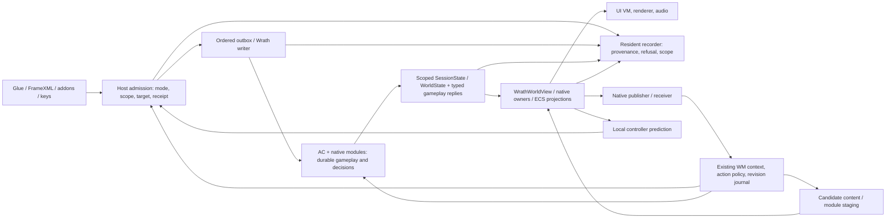

# RustWrath release architecture review · 5 November 2026

**Release-readiness verdict: FAIL for replacement and full platform.** A player can reach Northshire on an earlier build. On the reviewed source, pressing a pet command or spending a talent can terminate at the client's Wrath adapter before the server sees it. Saving an item into the last bank slots can succeed on the server while the translated player fields omit the result. Recoverable Windows delivery and combined platform operation still need demonstrations. These are independent release blockers.

Start implementation with [dispatch packages and release gates](release-backlog-2026-11-05.md). The [family matrix](release-matrix-2026-11-05.md) defines the behavior slices and remaining inventory. The [starting roadmap](release-plan-2026-11-05.md) preserves the earlier review.

## Review baseline and authority

|Source|What it establishes|
|---|---|
|Fetched Dicetar/RustWrath `origin/main` at `46fd2f0c2af476b3659116f0fc8c95900bde95a0`; roadmap commit `0bb7f4f79185da8cbeab6c7f439712a78121e9b2` has that exact parent. Its text describes the earlier `dbaf8eac` review pin.|Source anchors below use **main**, even where the supplied working directory was on another branch. Workspace Cargo.toml selects Bevy 0.18.1. No new engine API or scheduler guarantee is assumed.|
|Owner-approved `D:/WOW/PROJECT_B_COMPLETION_PLAN.md` §§1, 5–10, 13; [owner amendments](../baseline/owner-decisions.md); [issue 18](../../.scratch/project-b/issues/18-stock-replacement-inventory.md)|Full baseline, installed extensions, live changes, Windows recovery; then all platform capabilities. The November decisions add independent movement, combat, procedural and story module lifecycles and prioritize alpha first. Server-disabled required features still need an owner disposition.|
|[Historical matrix](architecture-traceability.md), [ADR-0001](adr-0001-wrath-compatibility-boundary.md), [ADR-0002](adr-0002-live-client-modules.md), [quest delivery contract](quest-command-delivery.md)|Two Proposed decisions. The first protects target fidelity; the second keeps session and gameplay authority resident. They are compatible if module outputs are validated proposals. Neither settles navigation, deployment recovery or live revision trust. Current main AGENTS.md treats donor code as useful where fitting; retain behavior relied on by existing callers, without forcing 12340 state through 1.12 representations.|
|[Identity](../baseline/identity-manifest.md), [route assets](../baseline/route-assets.md), [server seams](../baseline/seam-maps.md); local AzerothCore source `D:/WOW/WM_BridgeLab/src/azerothcore` at `5e741c37364f4ec5e3bc2860bcf21f13812fb66d`|Packet layout and server ownership. Source identity and the binary actually deployed are separate evidence. WM implementation belongs under `D:/WOW/wm-project`, deployment copy under BridgeLab. No DB or runtime inspection in this review.|
|Preserved `D:/Projects/wowdecomp-reference` at `e67b6ffef23655dc7da061cb2d36b7963f6ef71a`|Compare UI behavior in `WoW/Source/Ui/{PetInfo,TalentInfo,BattlefieldInfo,Calendar}_Scripts.cpp`; e.g. `Script_GetPossessInfo`, `Script_LearnTalent`. Read target assets and callers for the selected profile. Reconstruction is a behavioral reference, never a source to copy.|
|[November V3 work list](../../public/assets/aistudio/RustWrath_Execution_Work_Packages_V3_2026-11-03_213b1e21.json), [November 4 integration record](../../.scratch/project-b/handoffs/2026-11-04-log-failure-batch-integration.md), [active ownership](../agents/active-ownership.md)|Prior work to reconcile at admission. Source inspection only for this review. A log dated earlier than a repair establishes the original symptom and cannot close or reopen that repair by itself.|

## Prioritized findings

File names below are repository-relative. `app` means `crates/benilla-app/src`, `wire` means `crates/benilla-protocol-wrath/src`, and `UI` means `crates/benilla-ui/src/script`. Each finding has a first dispatch owner in the backlog.

|Priority / classification|File and function evidence at the review pin|Player or release consequence / assignment|
|---|---|---|
|P0 · source defect, incoming **and** outgoing inventory|[app/wrath.rs](../../crates/benilla-app/src/wrath.rs) `push_player_inventory_fields` copies 48 dwords from 402, 12 from 458. That exposes 24 of 28 bank GUIDs and six of seven bag GUIDs. `push_item_fields` copies 21 enchant words. `wrath_item_pos` and `wrath_bank_bag` take donor slot addresses on outgoing operations. Bank UI `ui_bank/mod.rs::feed_bank` and `ui_bank/net.rs::on_show_bank` consume projections.|An open bank window proves very little about the last slots or the address used for a subsequent move. **I** owns a lossless view and both directions of addressing. Server data may be intact when the display is wrong.|
|P0 · absent command consumers|[ui_pet/drain.rs](../../crates/benilla-app/src/ui_pet/drain.rs) `finish_press` sends `ClientCommand::PetAction`; [ui_talent.rs](../../crates/benilla-app/src/ui_talent.rs) `apply` sends `LearnTalent`. Both have handlers in donor `app/net/io.rs`. Neither has an encoding arm in `wrath_tap_commands` (match ends at `_ => None`). AC `PetHandler.cpp::HandlePetAction` and `SkillHandler.cpp::HandleLearnTalentOpcode` are separate server entry points.|The pet may render as friendly and a talent tree may show ranks while those presses never reach AC. **K** delivers one pet order and one talent spend separately, with refused and reconnect cases. **L** enumerates every remaining default arm by normal producer.|
|P0 · required installed addon has no native request/poll host|Installed `WM_Multiclass.lua::request` checks for `MulticlassRequest` and displays a patched-executable requirement if absent. Its frame polls `MulticlassPoll`. WM owner `client_extensions/multiclass/MulticlassClient.cpp::RegisterApis` supplies both to the patched original. `native_modules/mod-multiclass/src/MulticlassProtocol.h` reserves 0x51b/0x51a. Neither binding was found in the reviewed Rust crates or the inspected local companion crates.|The fork cannot complete this required multiclass workflow even with working self-whisper for Spellwright. **U4** implements the negotiated Glue/world request and reply interface; capture a real list/preview/commit and talent refresh.|
|P0 · absent release denominator / acceptance|[Issue 18](../../.scratch/project-b/issues/18-stock-replacement-inventory.md) leaves its acceptance boxes open. October's traceability covered families. No pinned full per-behavior ledger with closure evidence was found. Current [matrix](release-matrix-2026-11-05.md) covers representatives and names remaining enumeration for each.|A green Northshire run cannot justify replacement. **L** maintains the issue 18 inventory continuously; **R** requires every mandatory row resolved.|
|P0 · delivery gap|[tools/launch-client.ps1](../../tools/launch-client.ps1) expects a repo-relative `target\debug\benilla.exe`, local data path and manifest. It configures addon roots, clears inherited environment and retains launcher logs. Inspecting that script yields no installed-version selector, coupled migration or interrupted-update recovery.|A developer checkout can launch while a clean Windows machine cannot install or restore the preceding release. **W** owns the release set and recovery rehearsal; **R** freezes one candidate.|
|P1 · distinct transport failure modes|[app/wrath.rs](../../crates/benilla-app/src/wrath.rs) `WrathControl::start` creates an unbounded `WrathSessionEvent` channel. `take_session_events` limits frame work to 64. Separate `WrathFeed::push_event` evicts the oldest of 16 entries, including lifecycle messages; native updates have a separate 64-entry lane and loss counter. `wrath_stream_movement` limits movement pressure, `wrath_tap_commands` bounds outbox admission and tracked accepts have receipts.|Simply bounding the first channel can deadlock cancellation; tuning its drain does nothing to preserve the second lane's transfer edge. A stalled consumer creates a source-level loss/retention risk. **T** owns ordering, lifecycle capacity and explicit recovery. No measured incident rate.|
|P1 · viable native owners already exist|[wire/session.rs](../../crates/benilla-protocol-wrath/src/session.rs) `SessionState::reduce`; `reducer.rs::apply_values` tracks delivered bits. `build_digest` distinguishes missing body fields; [app/wrath_native.rs](../../crates/benilla-app/src/wrath_native.rs) `apply`, `invalidate_scope` and `update_from_gameplay` already own cast state. `wrath_apply_world` projects player XP 634/635 to 716/717 and traces deltas. Some other fields read a dense raw vector via `get`.|Start at first missing datum: server award, delivered field, owner, Lua event or pixels. Do not implement a parallel spell/XP store or call an XP award missing from a static screen. **A**, **I**, **K** migrate only proven losses and keep explicit clear distinct from never delivered.|
|P1 · reachable host path, missing transaction|[profile_source.rs](../../crates/benilla-assets/src/profile_source.rs) `ProfileAssetReader::reload` reopens a candidate. [lifecycle.rs](../../crates/benilla-app/src/ui_script/lifecycle.rs) `run_pending_reload` supersedes panel presentation, closes the old VM, installs a boot VM, loads UI; outstanding transport receipts survive. No common commit of GPU handles, catalogs, profile and UI in these calls.|Publication can change future reads while visible equipment or UI continues using earlier data. Failure after UI teardown needs recovery. **H** stages dependent consumers; **V** owns delivery to negotiated clients.|
|P1 · data types without gameplay consumers|[hotpatch host](../../crates/benilla-hotpatch/src/lib.rs) `Loaded::open` resolves the pose symbol; `Host::evaluate` processes bones/rigs. `ModularGameplayRegistry::set_seam_enabled` records flags; production call search found no gameplay loader using it. [ABI](../../crates/benilla-hotpatch-abi/src/lib.rs) movement can return an opcode; combat returns stamina, hit target and trigger spell. [combat_mode.rs](../../crates/benilla-app/src/combat_mode.rs) `request_experimental` returns `NotSent`.|Trusting these outputs as commands or hits would bypass host and server authority. **M** installs the second real adapter, **E** negotiates combat. Prove supported pose activation on an actual live rig separately.|
|P1 · external capabilities and product decisions|AC `Maps/Map.h::InsertGameObjectModel`; WM `wm_bridge_spawn_actions.cpp::ExecuteWorldSpawn`; `src/wm/world/bundle.py::run_bundle`; [procgen wm_draft.rs](../../crates/benilla-procgen/src/wm_draft.rs) `build`, `verify`, `cleanup_draft`. These owners cover different parts of placement, artifact import and cleanup.|Dynamic GO collision is conditional on model/config. It does not change precomputed NPC navigation. A valid draft has no durable live instance until consumed and reconciled. **B**, **G**, **S** need server authority, navigation agreement and a resumable journal.|
|P1 · release evidence missing for working pieces|[B-001B-1](../live-rules/B-001B-1-contract.md) and WM `SpellmakingV3.cpp::{Command,Purchase,Configure}` identify a live purchase/configuration path. `addon_message.rs::install_wrath` → `ui_chat/input/send.rs::addon_whisper` → targeted `ClientCommand::Chat` already carries self-whisper. WM `wm/autoplay/service.py` starts `wm_native/runtime.py::NativeObservationRuntime`. |Preserve both existing adapters. Neither a native ACK nor an addon registration demonstrates consumed character context, stable A/B selection, or in-flight rollback. **N**, **V** close those boundaries on the actual deployment.|

## Branch and repair disposition

* The inspected integration checkout `D:/Projects/rustwrath-main-integration` at main has local edits to `quest_trace.rs` (an `ExportWriter`/Condvar for manual export and exit), `benilla-hotpatch/src/lib.rs` (validate host frame before consuming history, deduplicate digest, try retained predecessors), `benilla-hotpatch-bevy/src/lib.rs` (restore outcome handling), ADR-0002 and an untracked roadmap. These are candidate repairs. **T/H** must compare diffs with the owners, record whether adopted or superseded, then request evidence. No cherry-pick of dirty source.
* Shared `project-b-client` was on `x00-cast-combat-diagnostics@3507a53f` with hundreds of tracked edits and untracked handoffs. X00 cast tracing, X02 transition, X04 click and X05 export branches have committed history reachable from reviewed main. Earlier G06-01…13 queue tickets and G01 route evidence can be found under the shared checkout's `.scratch/project-b`; some handoffs exist only there. Revalidate each ticket against the current adapter. No blanket diff import.
* `fix/log-dbc@44bdc541`, `fix/log-pet-model@a704cec8`, `fix/log-ui@dd2df6b3` and `fix/hourly-lfg-merchant@be5ae72b` are integrated ancestors. The pet fix translates ownership GUIDs; an earlier descriptor rewrite was reverted. Body display fallback and sparse-field fixes landed (`9e797d98`); the missing avatar still needs visible confirmation. `aa6ad2ce` fixes the quest-details tail and trainer re-entry. `wrath_move_flags` translates root, falling/far and transport. Do not copy October's broken labels forward as fresh source defects.
* Compared to the starting roadmap baseline, main contains `f0cae819` (party LFG aura predicates), `7d958298` (guild-bank repair binding), `bc8b9f1d` (channel display queries), alongside earlier `361ed227` (cooldown expirations), `f0771e9f` (debuglocals). Source closes narrow questions; LFG queueing, actually repairing an item and receiving channel messages still need distinct workflows. The worktree names under `F:/AI/tmp/opencode` refer to these merged repairs.
* `D:/Projects/project-b-opencode` holds local profile edits, native receiver material and an untracked `benilla-combat-core`; `D:/Projects/project-b-opencode-assets` holds local ADT/M2/SKIN/liquid and profile edits. Compare actual blobs to main before porting. The receiver also exists in the **WM owner tree**. Use the offline combat model as input, never as the deployed authority. `rw-log-dbc` has a local audit handoff. No worktree outside the planning checkout was edited.
* The earlier G01 handoff records world entry in run `20261102-222346-059`. A retained later launcher run, `project-b-client/benilla-config/Logs/Launcher/20261104-221213-669`, has PID 26396 and executable SHA-256 `DA8292933AFBFFF293644639548985D7A5D1470E11B94BF311C3BE75C94D76C1` in `launch.txt`. Its `stderr.log` records world 0 entry (98 entities) and the in-game UI coming up. This supports historical world entry on that executable. It does not certify the current-main route, NPC correctness, upgrades or rollback. The November 4 integration handoff preserves the earlier failing log and the source repair identities.

## Writers and normal event flow

The schedule matters for fixes that share a frame. In `WrathNetPlugin::build`, PreUpdate chains session ownership → shutdown → login → pick admission. In `WorldStage::Net`, Update chains **net drain → apply world → WM action intake → tap commands → dispatch session events**. The controller owns input, then `WorldStage::Stream` emits movement. The socket worker runs asynchronously. An accepted UI command and its server delta can occur in different frames. A transfer barrier must cover both the latest digest and the ordered event queue before either mutates a replacement world.

|State|Authoritative writer / lifetime|Publication and retirement|
|---|---|---|
|Character, items, money, quest flags, damage, talents, instance rights|AC character/world owners and DB, across sessions|A write receipt ends transport ownership only. Confirm with server outcomes and fields. Re-read after reconnect. Never replay an ambiguous purchase/reward automatically.|
|Received object, cast and session replica|IO worker SessionState/WorldState; app-native cast and object views are scoped projections|Tag epoch, world generation and entity incarnation; discard stale UI requests/results before mutation. Transfer retires entities, pending WM requests and transient UI. Preserve player data only through authoritative rehydration.|
|Predicted transform, camera, animation|Resident controller and render hosts, frame lifetime|Input → validated movement proposal → single wire writer. Correction wins. Pose restores saved locals after composition. Modules own no socket, world, GPU handle, durable GUID or borrowed pointer.|
|UI and local state|VM owns current widgets; settings, bindings and SavedVariables are keyed to account/character and realm. Host owns pending transport.|On reload persist appropriate state, supersede presentation, create new VM, feed authoritative facts. On reconnect keep local settings and reacquire gameplay. Never resend because a panel rebuilt.|
|WM observation, policy, publication|WM selects a fresh scoped observation or fallback; AC commits approved changes. Proposed journal keys every effect by request, instance and immutable revision.|At activation switch selection for new work; running work pins old semantics. Drain references before unload; reject candidate or restore last-good without deleting characters or settled rewards.|

The two proposed ADRs express compatible ownership but leave a material interface decision: the gameplay ABI can suggest a wire opcode or hit, while the host must remain the writer and AC the arbiter. Resolve with range/authority validation and a second real processor before generalizing the pose loader. Required decision records in dependency order are (1) scope and lossless replica/admission, (2) revision trust, in-flight ownership and recovery across host/WM/server, (3) spatial authority and deployment. No engine upgrade is a prerequisite.

Two details affect assignment. On reviewed main, `Host::evaluate` emits `RestoreOutcome::Restored` when it pops a predecessor, before that predecessor passes evaluation. A malformed common input can fail repeatedly as the loop consumes history. The integration checkout repair checks host input first and reports restoration only after a predecessor evaluates successfully. H1 should review that change before another worker writes one. Also, `SpaceModuleV1::generate_chunk` returns procedural spawn descriptors. Its interface has no terrain mesh/collision publication. `StoryModuleV1::evaluate` returns quest directives without durable grant ownership. G3 and S must cross those actual gaps to reach their release gates.

**Audit boundary.** No advertised or locally located Z.A.E.B.A.L. skill was available. The completion audit here instead checks both release joins, each §8 family, stable C IDs, first-batch file ownership, branch ancestry and remote publication. No engine build, test, server, client, profile reload or installer was run. All connected scenarios in these documents are future acceptance work.
