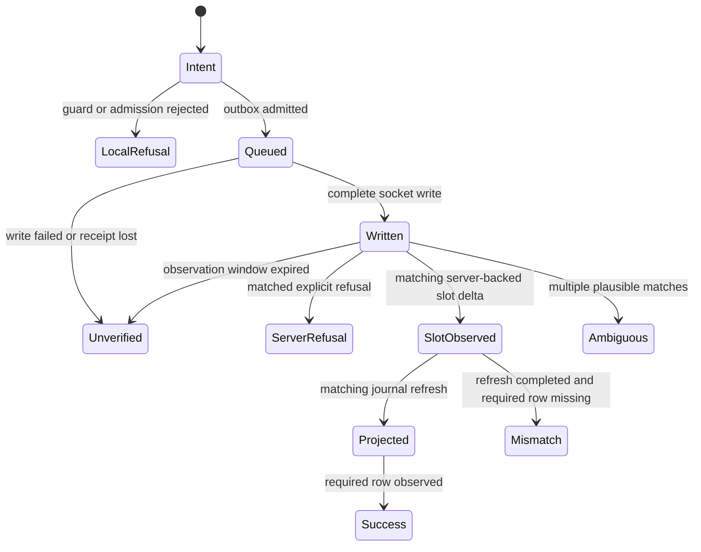

# D00 RFC — resident interaction diagnostics

**Owner decision, 2026-11-03.** Enable bounded in-memory tracing by default in the private Wrath alpha, with a local inspector and user-initiated, redacted export. The owner subsequently clarified that the recorder must cover other diagnostic vectors as well as quests. The host owns the recorder across Lua reloads. The gameplay owners continue to decide whether a command is sent and how server updates apply.

The recording policy is accepted. Source baseline is wotlk at `236b1a7aebc017655f9a0fc0dea54e52dae891ef` with the local G04/G05 delivery changes. This document specifies D01 onward.

## What a player should see

For a click that closes a quest panel without adding a journal row, show the quest, last confirmed milestone, evidence gaps and any explicit refusal. “Outbox full” requires a refusal from the tap. “Journal mismatch” requires an observed quest-slot change and a completed journal refresh for that change. When only a socket write is known, show “sent, outcome unconfirmed.” An already active quest requires a before/after comparison or an explicit server response before assigning an outcome to the click.

## Where to observe

| Existing owner | Proposed observation |
|---|---|
| `ui_quest/verbs.rs`, select and accept | Allocate one host-local interaction ID per intent, before guards. Record guard and channel outcome. Carry that ID through the G05 receipt. |
| `wrath.rs::wrath_tap_commands` | Record encoding, outbox admission or refusal from the actual decision. Preserve FIFO and existing movement rules. |
| `wrath.rs::run_session_with_cancel`, `benilla-protocol-wrath/src/world.rs::send` | Record written after both header and body writes return successfully. A partial-write failure leaves the server outcome unknown. The donor wire tracer is a separate transport. |
| Wrath receive loop, `session.reduce`, `gameplay::parse` | Record allowlisted opcode receipt, decode outcome and actual domain dispatch separately. Observe the existing parse result once. A successful reducer call alone cannot establish a changed quest slot. |
| `wrath_apply_world`, WrathQuestSlots, QuestLog, quest feed | Capture the relevant slot delta, projection revision, panel event and journal row independently. A queued UI event establishes dispatch only. Visible rendering requires a separate observation. |
| `ui_script/lifecycle.rs::run_pending_reload`, UiScript diagnostics | Before VM disposal, capture row kind, VM generation, row sequence and occurrence delta. Existing rows can increment without changing sequence. Track bounded last-seen counts by generation/row, report eviction gaps, and advance VM generation on replacement. Avoid cloning all raw messages per frame. |
| `debug_panel/journal.rs::record_casts`, CastJournal | Existing separate cast history retains 24 rows and displays ten. Later combat instrumentation can observe the same typed cast edges. Never infer an exact cast/impact match from the journal's newest matching spell alone. |
| Debug panel and local collector | Inspector reads a recorder snapshot. Existing collector includes free-form log text and remains a separate artifact. Build the proposed export from allowlisted structured values. |

## Proposed V1 types

| Type | Contract |
|---|---|
| Scope | Host run ID, protocol mode, session epoch, world generation, optionally UI VM generation. A new run receives a new ID irrespective of PID reuse. |
| InteractionId | Host-minted monotonic u64 within one run. Internal transport only. |
| DiagnosticEventV1 | Version, scope, event sequence, producer-relative monotonic time from a common host origin, optional interaction ID, closed domain/operation/milestone/reason enums, optional numeric subject and revision. |
| IncidentV1 | Version, scope, case ID, operation, outcome, confidence, bounded evidence sequence references, gap flags and last confirmed milestone. Evicted evidence remains explicitly unavailable. |
| SnapshotV1 | Run metadata, highest included event sequence, retained sequence range, incidents, evictions, rejected ingress and sampling counters. Unknown versions return an unsupported-version error before decoding records. |

Use a host-owned Bevy resource wrapping a plain Rust recorder. Producers submit fixed-size evidence records to a bounded nonblocking ingress. A single host drain assigns sequence in observed ingestion order. Producer timestamps and boundary-local ordering distinguish concurrent events. Late arrival never fabricates causality. A failed diagnostic enqueue increments a loss counter independently of the full queue and returns immediately.

Proposed first limits are 256 ingress records, 1,024 retained events, 64 incidents, 64 open interactions, eight sequence references per incident and a drain budget of 64 records per frame. Preallocate rings. Reuse bounded numeric fields and enums. The oldest retained records may be evicted with counters. On interaction capacity exhaustion, record tracking loss and allow gameplay to proceed. Snapshot copies are requested explicitly on the single owning thread at a drain boundary. Encoding and file writes consume that bounded copy off the frame thread. These capacities are initial design choices. D02 measures record size, high-water marks and frame cost before adopting performance targets.

## Evaluation and lifecycle



The diagram describes the contract's evidence requirements. Ingress can deliver evidence out of order. Cache bounded candidates within the same scope and reevaluate when the missing evidence arrives. Exact confidence requires a carried local ID or an explicit authoritative ID. One matching operation, subject, NPC and scope with a compatible time window gives strong confidence. Missing keys reduce it to heuristic. Multiple eligible candidates yield ambiguous. Zero candidates yield unmatched. Never reuse an event from an older session or world. An observed telemetry gap makes any negative conclusion that depends on the missing interval unverified. Preserve late evidence as an amendment with its own sequence.

On disconnect or world change, retire open interactions for the old scope. Retain their history and report cancellation for unfinished local work, or an unverified server outcome if a write already occurred. On Lua reload, retain host transport evidence, close old VM presentation expectations as superseded, and require a fresh projection in the new VM before evaluating its row. The evaluator never resends an action.

## Deterministic example

Illustrative exported event, using run-local aliases for actor identity. It represents a refusal before a socket write.

```json
{"version":1,"run_id":"example","event_seq":42,"elapsed_ms":120,"mode":"wrath_12340","session_epoch":3,"world_generation":7,"vm_generation":2,"interaction_id":8,"domain":"quest","operation":"accept","quest_id":783,"npc_alias":4,"milestone":"outbox_rejected","reason":"capacity"}
```

Given event 40 intent, 41 channel admitted, and 42 above, expect one local-refusal incident with exact confidence and evidence [40,41,42]. Given two eligible intents for the same NPC and quest, both written before a journal change, that change alone cannot identify the responsible intent. Expect ambiguous candidates. Given a slot delta plus a completed refresh during an interval with dropped events, expect unverified unless the row observation itself conclusively establishes the outcome.

## Inspector and export

The inspector shows recent interactions, last confirmed milestone, reason, confidence and loss counters. A user can expand the event chain and preview an export. An allowlisted local JSONL bundle includes schema, source revision, executable hash, selected profile and active revision when known. Mark unavailable identity fields unknown. Export run-local subject aliases and relative timestamps. Omit credentials, account names, raw GUIDs, chat, free-form Lua strings, paths and packet bodies. Keep screenshots and manual notes outside the initial format. Collection stays in memory until the user explicitly saves a local report.

## Decision and acceptance

The owner selected default-on recording with manual local export. The current source records quest selection and acceptance intent and outbound delivery, observed quest panels, server-backed slot additions/removals, and journal model projection. It also records session and world transitions, native cast/channel edges and loss, inventory failures, selected loot/vendor/gossip/quest events, and hotpatch milestones. Item text, chat, account information, target GUIDs and free-form loader errors are excluded. The debug panel shows possible or ambiguous slot matches. These are observations, not proof that a row was rendered or a particular server action succeeded. Once per second and just before reload, the host reads bounded Lua diagnostic row metadata without cloning message text. It records occurrence deltas, VM session and detectable sequence gaps, and resets the cursor when the VM changes.

The Wrath receive loop records allowlisted opcode receipt, reducer result and gameplay
decode result without packet contents. Object-update packet metadata is sampled one in 64;
seen, sampled, and omitted counts plus the interval are exported. Quest-slot changes are observed separately and are not sampled.
An absent sampled packet record is therefore not evidence that the server sent no update.
The UI observer also records whether the stock questgiver, quest-log, merchant, loot,
spellbook, character and game-menu frames are missing, hidden or effectively visible.
Effective visibility is UI model state, not proof of successful layout, hit testing,
occlusion handling or rendered pixels. The hotpatch activation event includes the verified
active module's content digest when available. A bounded restore outcome follows each
active-module frame failure: `RestoredPrevious` names the failed attempt, the restored
attempt when retained and the restored module's digest or `unknown`; `RestoreUnavailable`
means no retained predecessor existed. A restored module that fails again reports another
bounded outcome, so one boolean never collapses repeated failures. Loader error text and
paths stay in the local log and are not recorded.
Physical UI presses record button, a coarse allowlisted target category, VM identity and
whether the UI reported consuming the press. No coordinates, arbitrary frame names or
keyboard input are retained. A missing named hit can also mean an unnamed frame. Input
records are not automatically correlated to later actions.
The inspector can display presses within two seconds before a sampled Lua error as possible
or ambiguous associations. Error capture is polled, so this is an observation window rather
than a precise error timestamp or proof of causality.
An allowlist of outbound combat, inventory, loot and merchant opcodes records queue
admission/refusal and socket-write results. These generic records have no action ID and
must not be treated as a correlated user intent or an authoritative result. Socket errors
are recorded without their free-form messages.
The observer samples mixer presence and voice-pressure counters, and receives five-second
mix-health summaries from the existing audio owner. It also observes movement queue
pressure and applied local corrections, world-camera/animated-rig counts, and one-second
summaries of real-time frame intervals. These are internal signals. They do not establish
that audio was audible, movement felt correct, pixels were rendered correctly, or the GPU met
a budget.

The Bevy asset observer records a coarse asset family and failure category, plus missed-event
counts, without retaining paths or free-form loader errors. It covers failures surfaced through
Bevy's untyped asset-failure message. Synchronous readers and renderer/GPU failures require
their own owner-specific instrumentation.

The debug panel can save a bounded allowlisted JSONL snapshot on a background thread in the local Logs/InteractionDiagnostics directory. The snapshot identifies pending ingress and lost events. It includes the build's stamped Git SHA and Cargo profile when available, a sanitized requested asset-profile name captured at recorder installation, and a SHA-1 hash of the executable file read during export. The hash identifies the file on disk at export time, which could have been replaced since process start. Dirty source state and effective asset profile remain unknown. Existing snapshots are never intentionally overwritten.

The inspector summarizes the most recent local action boundary and displays refusal reasons. Raw 64-bit NPC GUIDs are mapped to bounded run-local numeric aliases (`npc_alias`) so raw GUIDs never enter the recorder ring or exported snapshots. Slot additions, observed panels (`GreetingPanel`, `DetailPanel`, `ProgressPanel`, `RewardPanel`, `GossipMenu`) and explicit quest-ID failure events are matched by quest, NPC alias, scope and a provisional 30-second observation window. Server refusals lacking a quest ID (`SMSG_QUESTLOG_FULL`, `SMSG_QUESTGIVER_QUEST_INVALID`) are heuristically matched against eligible written quest actions in the same scope and NPC alias within the window. Asynchronous quest template landings (`SMSG_QUEST_QUERY_RESPONSE`) also emit `JournalProjection` and `JournalRowInModel` observations so first-time uncached quest accepts complete projection evaluation. On Lua `/reload`, projections from an older VM generation are marked superseded until a fresh projection occurs in the new VM. On disconnect or world transfer, open interactions in the retired scope are closed as `LocalRefusal` (if not yet written) or `WriteUnconfirmed` with `Unverified` confidence (if already written to the socket).

The host retains up to 64 loss-aware incidents with `IncidentConfidence` (`Exact`, `Strong`, `Heuristic`, `Ambiguous`, `Unverified`, `Unmatched`), telemetry-gap flags, and up to eight event sequence references. Duplicate same-NPC `Open` or `Accept` writes resolved by a single panel or slot delta record `AmbiguousServerOutcome`. The export includes `"version": 1`, `"highest_retained_sequence"`, `"interaction_tracking_lost"`, `"npc_aliases_assigned"`, `"panel_correlations"`, the retained sequence range, per-vector `retained_evictions` whose sum equals the global `evicted` count, a bounded `retention_summary`, recent bounded summaries and the last observed hotpatch content digest, and `validate_snapshot_header` rejects unknown schema names or versions before decoding records. Confirmed visible pixel rendering, inbound packet-to-action wire attribution without server IDs, and target-client runtime validation remain pending.

Hotpatch attempt correlation shows each retained attempt's latest bounded terminal,
including frame failure followed by a restored predecessor (attempt and digest, or
`unknown`), an explicit no-predecessor fallback, rejection, withdrawal, and unresolved
matches when a restore event was lost. Trust policy and memory isolation are not claimed.

### Evidence-class retention (additive to v1)

Retained rows are classified into `action`, `health`, `protocol` and `unclassified`
independent of their diagnostic vector. Periodic health rows (frame, asset, scene,
replica, movement pressure, audio, UI frame visibility) are capped at 256 of the 1024
retained rows and reclaimed before action/protocol evidence while retained health exceeds
a 64-row reserve. An incoming health row reclaims an older health row, so periodic traffic
never displaces action evidence while any health row is retained; action pressure reclaims
health down to the reserve, then its own oldest row. This protects the action chain that
explains an incident while still exposing health loss in dedicated counters rather than
suppressing health producers. `dropped` is the classified
ingress loss sum, so the per-class counters reconcile with the global counters including
`unclassified`, and health-only churn does not turn an action conclusion into a telemetry
gap by itself. Incidents keep their bounded `evidence` sequence references and add up to
eight self-contained `evidence_notes` (`seq`, `elapsed_ms`, `class`, `stage`) resolved
before eviction, with `evidence_notes_truncated` when older notes are dropped. The opening
and terminal notes stay readable in the inspector and saved report after their rows leave
the ring. All fields are additive to schema `rustwrath.interaction-diagnostics.v1`,
version 1; readers that only know `evidence` and `missing_event_sequences` are unaffected.


After approval, D01 owns types and version rejection, D02 owns storage/lifecycle, D03 owns correlation, D04/D05 own outbound and inbound hooks, D06 owns the VM bridge, and D07 owns export. Focused unit tests in `crates/benilla-app/src/quest_trace.rs` cover full ingress without blocking gameplay, exact local-refusal evidence chains, duplicate same-NPC clicks, stale-world scope retirement and isolation, repeated Lua rows and projection superseding across reload, partial socket writes and malformed quest packets, and NPC alias export privacy plus version rejection. Runtime execution and gameplay acceptance remain pending.
